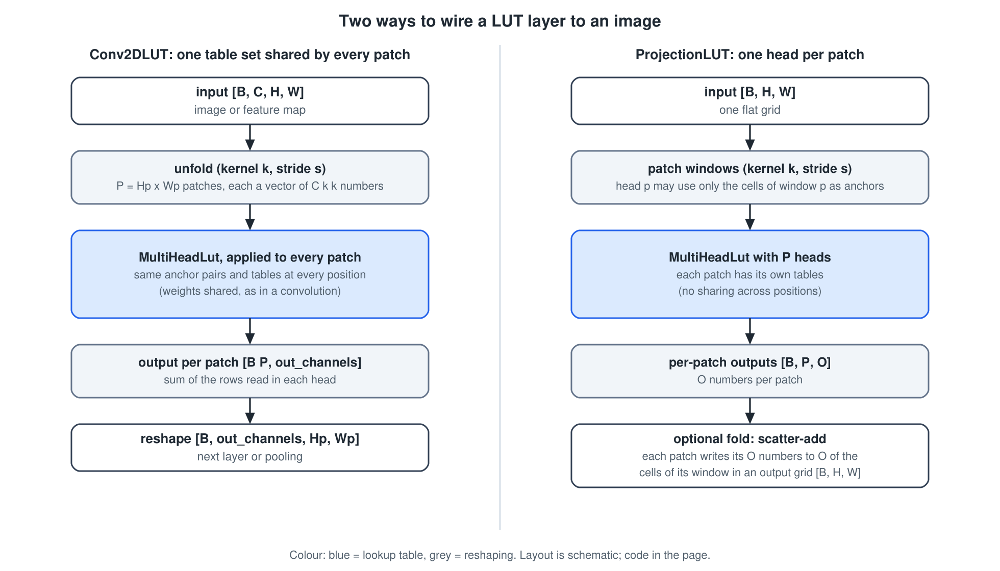

# Convolutional networks

LUT layers that look at an image patch by patch, and the image classifiers built from them (MNIST and CIFAR-10). The work was done between November 2025 and March 2026 and stopped when the language-model work started.

## Idea / model

A LUT layer reads a vector, so an image has to be cut into vectors first. Both layers below use the same recipe as `torch.nn.Unfold`: slide a window of kernel size $k$ and stride $s$ over the image, and give the content of each window to a [multi-head LUT](../lookup-table-primitives/README.md) (anchor-pair sign bits give an address, the addressed table rows are summed). They differ in what is shared between windows ([diagram](figures/conv_lut.svg)).

- **[`Conv2DLUT`](https://github.com/anatoli-starostin/spiky/blob/3ac72cca40c63b77d509d4ccff33bb85d43e515e/src/spiky/lutorch/multi_head_lut.py#L487-L619)** works like a convolution. The window of all $C$ input channels becomes one vector of $C k k$ numbers, and one multi-head LUT, with the same anchor pairs and the same tables, is applied to every window. The output of each window is `out_channels` numbers, and the outputs are put back on a grid of $H_p \times W_p$ positions. The weights are shared across positions, so the layer can be stacked like a convolutional layer.
- **[`ProjectionLUT`](https://github.com/anatoli-starostin/spiky/blob/3ac72cca40c63b77d509d4ccff33bb85d43e515e/src/spiky/lutorch/multi_head_lut.py#L265-L484)** works on one flat grid `[B, H, W]` and gives every window its own head: the anchors of head $p$ are restricted to the cells of window $p$, and the tables are not shared. The `n_outputs` numbers of each window can optionally be written back to a grid of the input size by scatter-add (the "fold" configuration), which makes the layer a drop-in, shape-preserving block. There is no weight sharing across positions, which costs parameters but lets each position specialise.
- **WTA variants** ([`WTA`](https://github.com/anatoli-starostin/spiky/blob/3ac72cca40c63b77d509d4ccff33bb85d43e515e/src/spiky/lutorch/multi_head_wta.py#L15-L112), [`ProjectionWTA`](https://github.com/anatoli-starostin/spiky/blob/3ac72cca40c63b77d509d4ccff33bb85d43e515e/src/spiky/lutorch/multi_head_wta.py#L115-L283), [`Conv2DWTA`](https://github.com/anatoli-starostin/spiky/blob/3ac72cca40c63b77d509d4ccff33bb85d43e515e/src/spiky/lutorch/multi_head_wta.py#L286-L383)): the address of a window is the position of its strongest cell (winner-take-all) instead of anchor-pair comparisons. They exist as modules with unit tests; we found no image experiment that uses them.

Both main layers use the smooth read with three alternatives per lookup (`smooth_mode=True`, `n_alternatives=3` in the MNIST notebooks): the $k=3$ blend of [backpropagation 2.3](../lookup-table-primitives/backpropagation.md#23-k-alternatives), which is the smooth read of [readout 2.1](../lookup-table-primitives/readout.md#21-manifesto-blend-soft-read), with the default uncertainty function $U(m)=0.5/(1+m)$ of the margin $m$ (`UncertaintyMode.INVERSE_L1`, the rational function of [backpropagation 2.2](../lookup-table-primitives/backpropagation.md#22-choices-of-u)). The same recipe was carried into the language-model work. The classifier on top of the last LUT layer was an ordinary dense linear layer in the MNIST notebooks, and an MLP in the CIFAR-10 runs.

## Why it matters / what was found

**MNIST.** Two models in one notebook reach 99.06% best validation accuracy: a two-layer `ProjectionLUT` model with 757,418 parameters and a three-layer `Conv2DLUT` model with 399,482 parameters, each followed by a dense linear classifier ([lutorch_mnist.ipynb](https://github.com/anatoli-starostin/spiky/blob/3ac72cca40c63b77d509d4ccff33bb85d43e515e/workbooks/lutorch_mnist.ipynb)). The first-generation layers ([`Conv2DLUTLayer`](https://github.com/anatoli-starostin/spiky/blob/3ac72cca40c63b77d509d4ccff33bb85d43e515e/src/spiky/lut_fused/LUTLayer.py#L1259-L1453), [`ProjectionLUTLayer`](https://github.com/anatoli-starostin/spiky/blob/3ac72cca40c63b77d509d4ccff33bb85d43e515e/src/spiky/lut_fused/LUTLayer.py#L1529-L1668), whose connections were grown by a synapse-growth engine) reached 98.29% with 376,390 parameters ([lut-mnist.ipynb](https://github.com/anatoli-starostin/spiky/blob/28631c785daea3430daf979ad54ed26451e2afa8/workbooks/lut-mnist.ipynb)) and 98.16% with 356,614 parameters in the fused version ([lut-fused-mnist.ipynb](https://github.com/anatoli-starostin/spiky/blob/3ac72cca40c63b77d509d4ccff33bb85d43e515e/workbooks/deprecated/lut-fused-mnist.ipynb)). These are single runs, reported as the best validation accuracy over the epochs, and the notebooks contain no dense convolutional baseline.

**CIFAR-10.** The results exist only as a written journal of 155 numbered experiments; the code that produced them is not in the repository (the journal was added to the repository on 2026-07-04, the runs themselves fall between March and about May 2026). Everything below is *claimed* in the journal: single runs, best validation accuracy, Adam with cosine schedule, random crop and flip.

- A classic AlexNet-shaped convolutional baseline reaches 89.36% at 20 epochs with 6.46M parameters ([experiment 1](https://github.com/anatoli-starostin/spiky/blob/e85a5ceca156e79d199b0f6b395aa8e7e4ee287a/claude-memory/main-h100/notes/spiky/experiments/experiments.md#exp01--classic-alexnet-baseline)), and 90.22% in a smaller version trained for 100 epochs ([experiment 146](https://github.com/anatoli-starostin/spiky/blob/e85a5ceca156e79d199b0f6b395aa8e7e4ee287a/claude-memory/main-h100/notes/spiky/experiments/experiments.md#exp146--alexnet-baseline-100ep)) ([journal](https://github.com/anatoli-starostin/spiky/blob/e85a5ceca156e79d199b0f6b395aa8e7e4ee287a/claude-memory/main-h100/notes/spiky/experiments/experiments.md)).
- The best all-LUT network found reaches 86.05% with 1.78M parameters ([experiment 106](https://github.com/anatoli-starostin/spiky/blob/e85a5ceca156e79d199b0f6b395aa8e7e4ee287a/claude-memory/main-h100/notes/spiky/experiments/experiments.md#batch-26-exp105exp112-convergence--topology-push), 46 epochs): five stages, tables with 5 anchor pairs, and "late downsampling", meaning two stride-1 stages at full 32 by 32 resolution before the first compression. The topology notes read: processing at large resolution before compressing is better than compressing early, skipping the 16 by 16 scale is catastrophic (a loss of 6.5 points), and larger kernels (5 by 5) hurt.
- Table geometry: the number of anchor pairs per table is the dominant bottleneck (moving from 10 to 8 to 6 pairs gained about 8 and 3.7 points at 20 epochs; 5 pairs per table proved the most parameter-efficient), more tables per head beat wider channels at equal parameters (about one point per doubling at 20 epochs), and more heads (more diverse anchor views of the same outputs) beat fewer. The same trade-off, many small tables over few large ones, carried over to the language models ([Hashing](../lookup-table-primitives/hashing.md#13-mixed-address-widths)).
- The LUT classifier at the end of the network converged about five times slower than an MLP on the same features; switching to an MLP head was "the primary lever" in the early phase.
- A first layer reading 3 colour channels is a weakness: the hybrid with a dense `Conv2d` stem and LUT stages (2.34M parameters) reached 88.00% at 50 epochs against 89.69% for the convolutional baseline of the same family, and the best hybrid variant reached 88.63% (experiments [144](https://github.com/anatoli-starostin/spiky/blob/e85a5ceca156e79d199b0f6b395aa8e7e4ee287a/claude-memory/main-h100/notes/spiky/experiments/experiments.md#exp144--hybrid-conv2dlut-reference-50ep), [145](https://github.com/anatoli-starostin/spiky/blob/e85a5ceca156e79d199b0f6b395aa8e7e4ee287a/claude-memory/main-h100/notes/spiky/experiments/experiments.md#exp145--alexnet-baseline-50ep), [149](https://github.com/anatoli-starostin/spiky/blob/e85a5ceca156e79d199b0f6b395aa8e7e4ee287a/claude-memory/main-h100/notes/spiky/experiments/experiments.md#exp149--hybrid-lut32-stride-1)). So the best LUT network was about 1.7 points behind the dense baseline of that family in the hybrid case, and about 3.6 points behind in the all-LUT case (86.05% with 1.78M parameters against 89.69% with 2.68M), always on single runs.

No reason for stopping the image work is written anywhere. The first language-model work on a nanoGPT-like setup starts on 2026-03-26 ([nanochat walkthrough](https://github.com/anatoli-starostin/spiky/commit/b279ffc265b16afa2cc3e89343518d5ce023203b)), and the last convolution commit is from 2026-03-21 ([4019bd6](https://github.com/anatoli-starostin/spiky/commit/4019bd6620a2d79248cdab908c68daa9b9fcd0ad)).

## Dead ends

- **Fused convolution kernels.** A version of `Conv2DLUT` whose CUDA kernels read the 4D input directly (`Conv2DLutFused`, pull request 45) was never merged and no reason is written; the code survives on a tag ([conv2d_lut_fused.py](https://github.com/anatoli-starostin/spiky/blob/f16c12f302792be2977d1ff0dd4dddbd725defc9/src/spiky/lutorch/conv2d_lut_fused.py)).
- **First-generation layers with synapse growth.** The first LUT and ANDN (AND-NOT spiking) layers grew their connections with a dedicated engine; the [`lutorch`](https://github.com/anatoli-starostin/spiky/tree/e85a5ceca156e79d199b0f6b395aa8e7e4ee287a/src/spiky/lutorch) layers replaced them ([andn.ipynb](https://github.com/anatoli-starostin/spiky/blob/f453ae40708c44a316a030d8e23570cf13921980/workbooks/andn.ipynb) is history only).

## Open ideas

- The WTA layers have no image result at all.
- Everything above is for 28 by 28 and 32 by 32 images; no larger images were tried (the notebooks called CIFAR and "ImageNet" use CIFAR-100, and the latter says it is a proxy).
- No dense baseline was trained in the same code as the LUT networks, so the gaps above compare runs of different code and data pipelines.

## Where it lives

All links are pinned to commits of [`anatoli-starostin/spiky`](https://github.com/anatoli-starostin/spiky).

| What | Link |
| --- | --- |
| [`Conv2DLUT`](https://github.com/anatoli-starostin/spiky/blob/3ac72cca40c63b77d509d4ccff33bb85d43e515e/src/spiky/lutorch/multi_head_lut.py#L487-L619), [`ProjectionLUT`](https://github.com/anatoli-starostin/spiky/blob/3ac72cca40c63b77d509d4ccff33bb85d43e515e/src/spiky/lutorch/multi_head_lut.py#L265-L484), [`UnfoldConfiguration`](https://github.com/anatoli-starostin/spiky/blob/3ac72cca40c63b77d509d4ccff33bb85d43e515e/src/spiky/lutorch/multi_head_lut.py#L218-L262) | [multi_head_lut.py](https://github.com/anatoli-starostin/spiky/blob/3ac72cca40c63b77d509d4ccff33bb85d43e515e/src/spiky/lutorch/multi_head_lut.py) |
| [`WTA`](https://github.com/anatoli-starostin/spiky/blob/3ac72cca40c63b77d509d4ccff33bb85d43e515e/src/spiky/lutorch/multi_head_wta.py#L15-L112), [`ProjectionWTA`](https://github.com/anatoli-starostin/spiky/blob/3ac72cca40c63b77d509d4ccff33bb85d43e515e/src/spiky/lutorch/multi_head_wta.py#L115-L283), [`Conv2DWTA`](https://github.com/anatoli-starostin/spiky/blob/3ac72cca40c63b77d509d4ccff33bb85d43e515e/src/spiky/lutorch/multi_head_wta.py#L286-L383) | [multi_head_wta.py](https://github.com/anatoli-starostin/spiky/blob/3ac72cca40c63b77d509d4ccff33bb85d43e515e/src/spiky/lutorch/multi_head_wta.py), [wta_lookup.py](https://github.com/anatoli-starostin/spiky/blob/3ac72cca40c63b77d509d4ccff33bb85d43e515e/src/spiky/lutorch/wta_lookup.py) |
| first-generation layers | [lut_fused/LUTLayer.py](https://github.com/anatoli-starostin/spiky/blob/3ac72cca40c63b77d509d4ccff33bb85d43e515e/src/spiky/lut_fused/LUTLayer.py) |
| MNIST workbooks | [lutorch_mnist.ipynb](https://github.com/anatoli-starostin/spiky/blob/3ac72cca40c63b77d509d4ccff33bb85d43e515e/workbooks/lutorch_mnist.ipynb), [lut-fused-mnist.ipynb](https://github.com/anatoli-starostin/spiky/blob/3ac72cca40c63b77d509d4ccff33bb85d43e515e/workbooks/deprecated/lut-fused-mnist.ipynb), [lut-mnist.ipynb](https://github.com/anatoli-starostin/spiky/blob/28631c785daea3430daf979ad54ed26451e2afa8/workbooks/lut-mnist.ipynb) |
| CIFAR-10 journal (no code) | [experiments.md](https://github.com/anatoli-starostin/spiky/blob/e85a5ceca156e79d199b0f6b395aa8e7e4ee287a/claude-memory/main-h100/notes/spiky/experiments/experiments.md), index in [MEMORY.md](https://github.com/anatoli-starostin/spiky/blob/e85a5ceca156e79d199b0f6b395aa8e7e4ee287a/claude-memory/main-h100/memory-bank/MEMORY.md) |
| fused convolution kernels (never merged) | [conv2d_lut_fused.py](https://github.com/anatoli-starostin/spiky/blob/f16c12f302792be2977d1ff0dd4dddbd725defc9/src/spiky/lutorch/conv2d_lut_fused.py) |

The diagram is generated by [`figures/make_figures.py`](figures/make_figures.py).

A note on names: `AnchorSamplingPolicy.CONV2D` and [`exp126_conv2d_d40p24_concat`](https://github.com/anatoli-starostin/spiky/tree/e85a5ceca156e79d199b0f6b395aa8e7e4ee287a/transformer_exps/exp126_conv2d_d40p24_concat) in the language-model folders are not image models ([lut_helpers.py](https://github.com/anatoli-starostin/spiky/blob/e85a5ceca156e79d199b0f6b395aa8e7e4ee287a/src/spiky/lutorch/lut_helpers.py#L11-L23)). They apply the convolutional idea inside a byte-level language model, as a strong prior on which pairs a table may compare. A table that compares arbitrary pairs of a wide input vector has to choose among a huge number of possible mappings from orderings to orderings, which is expensive to compute for wide inputs (the problem we were trying to address at the time). Adding an artificial spatial constraint, so that each table sees only a local window of the vector, restricts the model to a relatively large subset of those mappings: large enough to encode information, but cheap to compute even with wide input vectors.
