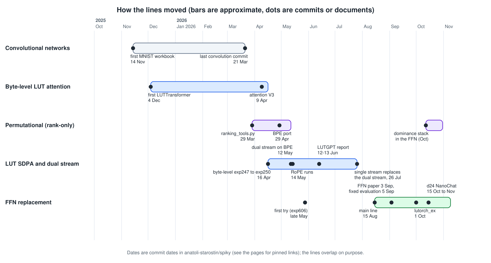

# How the line moved

A short timeline of the architectures, for orientation only. The ideas are described by topic in the pages linked below; here we only say when each was tried. The periods overlap on purpose: several ideas were worked on in parallel, and the data set (bytes, then the NanoChat BPE corpus) does not separate the ideas. Dates are commit dates in [`anatoli-starostin/spiky`](https://github.com/anatoli-starostin/spiky); the experiment folders of the byte-level series have no dates of their own (they entered git in one commit on 2026-04-13), so their dates are inferred from the code around them.

## Timeline

1. **Before the transformers (October 2025 to March 2026).** The first commit already contains Eugene Izhikevich's toy transformer in C (October 2025), and the first LUT layers and an MNIST notebook date from November 2025. Image classifiers are worked on until the last convolution commit on 2026-03-21, when the language-model work takes over. See [Convolutional networks](convolutional.md) ([first commit](https://github.com/anatoli-starostin/spiky/commit/f453ae40708c44a316a030d8e23570cf13921980), [last convolution commit](https://github.com/anatoli-starostin/spiky/commit/4019bd6620a2d79248cdab908c68daa9b9fcd0ad)).
2. **Byte-level LUT attention and positional encodings (December 2025 to April 2026).** The first [`LUTTransformer`](https://github.com/anatoli-starostin/spiky/blob/e85a5ceca156e79d199b0f6b395aa8e7e4ee287a/src/spiky/lut_fused/LUTTransformer.py) is from 2025-12-04 ([commit](https://github.com/anatoli-starostin/spiky/commit/cf45631e7cf2f79ef4187fb242bed165525ce587)); pairwise LUT attention follows on 2026-03-11, and its version with a softmax over LUT scores (V3) on 2026-04-09. Vocabulary 257, context 32 and then 128. See [LUT attention](transformers/lut-attention.md#earlier-lut-attention-models-byte-level-march-to-april-2026) and [Positional encodings](transformers/positional-encodings.md).
3. **The permutational line (March to May 2026).** [`ranking_tools.py`](https://github.com/anatoli-starostin/spiky/blob/e85a5ceca156e79d199b0f6b395aa8e7e4ee287a/src/spiky/lutorch/ranking_tools.py) (ranking attention) appears on 2026-03-29, the vote-based tables on 2026-04-16 to 04-22, and the pure permutational transformer of the article is byte-level and from April. The port to the NanoChat BPE data (vocabulary 32768, context 512) is on 2026-04-29, still with a single rank-only stream; the last ranking-attention result is from 2026-05-07. See [Permutational transformers](transformers/permutational.md) ([ranking_tools commit](https://github.com/anatoli-starostin/spiky/commit/faafce7af996ce7ff44b07baeb2d6b2aa8808663), [BPE port](https://github.com/anatoli-starostin/spiky/commit/365c795022bb75547274ff27a73cdc020ef4fa04)).
4. **LUT SDPA and the dual stream (April to July 2026).** LUT queries and keys into classic attention are already in the byte-level runs of 2026-04-16, which also contain the first dual stream; raw SDPA on LUT-emitted queries and keys on BPE data follows in May; the dual stream on BPE data is from 2026-05-12, RoPE from 2026-05-14, the soft-forward and then hard-forward decision of 2026-05-20 moves the work to the hard forward, and the June 2026 report on LUTGPT is dated 2026-06-12 and 06-13 ([report commit](https://github.com/anatoli-starostin/spiky/commit/36d240ef85997465b1cd280d55dc9f3a3cee080a)). The dual stream is replaced by a single stream on 2026-07-25 and 07-26. See [LUT attention](transformers/lut-attention.md#lut-sdpa), [Permutational transformers](transformers/permutational.md#the-dual-stream) and [Unembedders](transformers/unembedders.md).
5. **FFN replacement with classic attention (late May 2026 to now).** A first LUT feed-forward in a classic model ([`exp606`](https://github.com/anatoli-starostin/spiky/tree/e85a5ceca156e79d199b0f6b395aa8e7e4ee287a/nanochat_exps/exp606_vanilla_lut_ffn)) is from late May and regressed. It becomes the main line on 2026-08-15 with a parameter-budget goal, the paper and its runs are merged on 2026-09-03 and 04, and the fixed evaluation is introduced on 2026-09-05; confidence forms follow in September, the [`lutorch_ex`](https://github.com/anatoli-starostin/spiky/tree/3ac72cca40c63b77d509d4ccff33bb85d43e515e/src/spiky/lutorch_ex) library from 2026-10-01 and the full-scale d24 NanoChat runs (context 2048, vocabulary 32768) from mid-October. See [FFN replacement](transformers/ffn-replacement.md) ([main-line commit](https://github.com/anatoli-starostin/spiky/commit/cd4efb5166a70c35a11396997f389be881da5783), [fixed evaluation](https://github.com/anatoli-starostin/spiky/blob/c4a750b2f9ab65efe6a61254103a92d6fd8fc2a2/experiments/ffn_replacement/FIXED_EVAL.md), [`lutorch_ex` start](https://github.com/anatoli-starostin/spiky/commit/6693d8bb5f1b851ddef1d11eaa8fb80c39105356), [d24 README](https://github.com/anatoli-starostin/spiky/blob/b38b57d70f4c30f877888ac148f9d9e60495b00d/experiments/lut_nanochat/README.md)).
6. **Other ideas** ([page](other-ideas.md)): the byte-level recursive LUT (April 2026) and the predictive-coding LUT stacks (September 2026).

## Naming that confuses readers

- The repository uses the word "hybrid" for five different things (a dense Q and K with LUT V, a soft-and-multi-alternative backward, a forward mode that blends two rows, a model with only the attention input soft, a dense plus parallel LUT feed-forward). The wiki calls the design with LUT queries and keys and classic scores **LUT SDPA** and keeps `hybrid_smooth` for the two-row forward mode.
- "NanoChat" names both the BPE corpus and tokenizer at context 512 (all the small-scale and fast test runs, 2026-04-29 onward, old evaluation) and the d24 upstream recipe at context 2048 (October 2026). The pages always state context length and vocabulary.
- The dual stream is one design throughout; only the widths changed: a narrow rank stream with a wide Euclidean stream (April to May), and 384 coordinates each in the June report ([Permutational transformers](transformers/permutational.md#the-dual-stream)).
- Experiment ids collide between the byte-level folder ([`transformer_exps`](https://github.com/anatoli-starostin/spiky/tree/e85a5ceca156e79d199b0f6b395aa8e7e4ee287a/transformer_exps)), the BPE folder ([`nanochat_exps`](https://github.com/anatoli-starostin/spiky/tree/e85a5ceca156e79d199b0f6b395aa8e7e4ee287a/nanochat_exps)) and the hyperplane folder ([`experiments/hyperplane_ffn`](https://github.com/anatoli-starostin/spiky/tree/0c35e3be8deab30338681013158ecbd166548764/experiments/hyperplane_ffn)); the pages name the folder.
