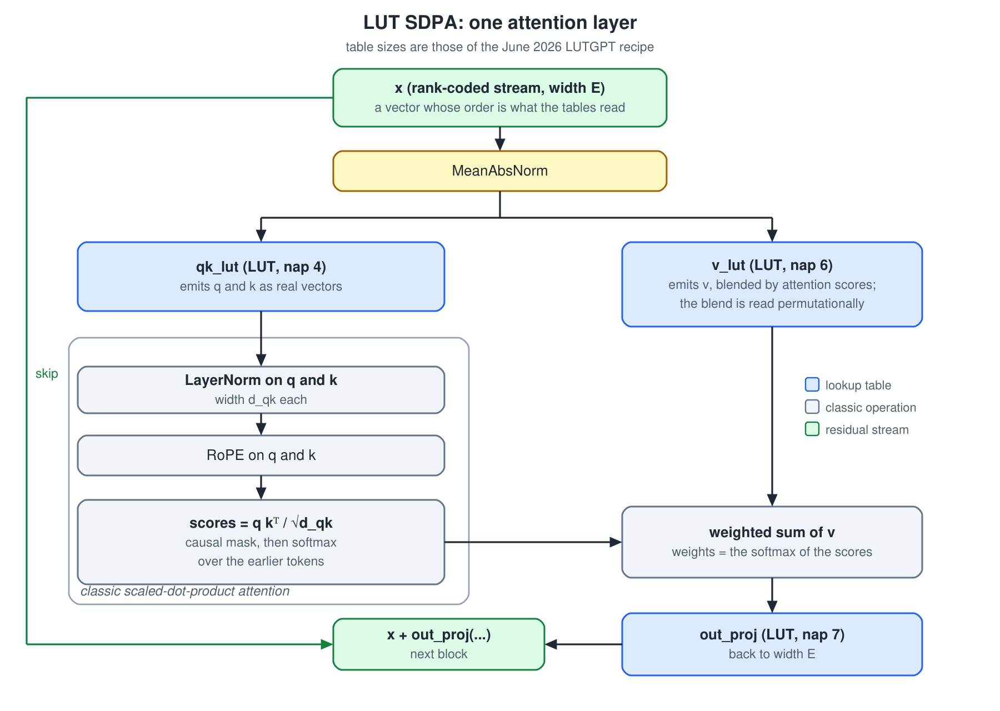

# LUT attention models

Attention blocks in which the queries, keys and values are produced by lookup tables instead of dense projections. The models we built differ in two things: how the attention scores are computed, and what travels between the blocks. This page follows the idea from the first models (scores from a table, tried on bytes) to the design that survived, **LUT SDPA**, and the June 2026 report that tested it at the fast test scale. The ranking-only variants (scores from rankings of vectors, no magnitudes between blocks) are on [Permutational transformers](permutational.md); positional information is on [Positional encodings](positional-encodings.md).

**Scales.** The first models are byte-level: vocabulary 257 (256 bytes and a begin token) and context 32, later 128. The BPE models use the NanoChat tokenizer and corpus with vocabulary 32768 and context 512 (the fast test scale of [Transformers](README.md)). All numbers on this page are from the old evaluation of [`CONVENTIONS.md`](../../CONVENTIONS.md) (a small validation window that depends on the batch size of training), single seeds, comparable only within their own batch of runs. Byte-level numbers are validation cross-entropy in nats, BPE numbers are bits per byte.

## Idea / model

A dense attention head computes $q_i = W_Q x_i$, $k_j = W_K x_j$ and $v_j = W_V x_j$. The scores are $s_{ij} = q_i \cdot k_j / \sqrt{d_{qk}}$, where $d_{qk}$ is the width of the queries and keys. The weights are

$$a_{ij} = \frac{e^{s_{ij}}}{\sum_{l \le i} e^{s_{il}}}$$

over the earlier positions $j \le i$, and the output is

$$o_i = \sum_{j \le i} a_{ij} v_j$$

The questions for a LUT model: which of these steps can be a table read, and what does the reader of the output (the next table) need.

### LUT SDPA

LUT SDPA keeps the classic scaled-dot-product scores and replaces the three projections by tables, each reading the same normalised input:

- **Q and K** (one table group, `qk_lut`) read the input through anchor-pair sign bits (the input is treated as a permutation: only the order of its coordinates is read) and emit real vectors $q_i$, $k_j$. These feed the usual scores, so the one operation that needs magnitudes, the dot product, stays classic. QK normalisation (LayerNorm on $q$ and $k$) and RoPE are applied on top ([Positional encodings](positional-encodings.md#idea--model)).
- **V** (`v_lut`) reads the input the same way and emits $v_j$, again a real vector. The real vectors $v_j$ are blended with the softmax weights, $o_i = \sum_j a_{ij} v_j$ (a convex combination of real vectors). The blend is where the values become permutational again: the sum is read by the `out_proj` table, which looks only at the order of its coordinates, so the V table has to be trained so that a blend of plausible V rows is still readable by `out_proj`.
- **Output** (`out_proj`) is an ordinary table that reads the blended vector and writes a row into the residual stream.

The June report states the roles in these words: the Q and K tables are the adapters from the rank-mediated stream into a real-valued representation that SDPA can read, and the V table must be trained so that its outputs remain mixable ([report](https://github.com/anatoli-starostin/spiky/commit/36d240ef85997465b1cd280d55dc9f3a3cee080a), section 3.5; the PDF is also in the main branch, [doc/lutorch/lutgpt_research_report.pdf](https://github.com/anatoli-starostin/spiky/blob/3ac72cca40c63b77d509d4ccff33bb85d43e515e/doc/lutorch/lutgpt_research_report.pdf)). Because the scores are classic, RoPE can be applied to $q$ and $k$. The Spiky repository never uses the name LUT SDPA; the code names are `qk_lut` followed by `F.scaled_dot_product_attention`, `v_lut` and `out_proj`.

The first instance of this design is older than the June report: the byte-level experiments [`exp247`](https://github.com/anatoli-starostin/spiky/tree/e85a5ceca156e79d199b0f6b395aa8e7e4ee287a/transformer_exps/exp247_no_residual) to [`exp249`](https://github.com/anatoli-starostin/spiky/tree/e85a5ceca156e79d199b0f6b395aa8e7e4ee287a/transformer_exps/exp249_no_res_small) of April 2026 have "Q/K LUT, QK-LayerNorm, SDPA, OutProj LUT, no FFN, no residuals" ([note](https://github.com/anatoli-starostin/spiky/blob/e85a5ceca156e79d199b0f6b395aa8e7e4ee287a/claude-memory/main-h100/memory-bank/project_permutational_architecture.md)). On BPE data raw SDPA on LUT-emitted Q and K ([`exp147`](https://github.com/anatoli-starostin/spiky/tree/e85a5ceca156e79d199b0f6b395aa8e7e4ee287a/nanochat_exps/exp147_real_qk_d64), May 2026) trained 0.12 to 0.14 behind exp144 and was stopped at step 1600; the working form is [`exp218`](https://github.com/anatoli-starostin/spiky/tree/e85a5ceca156e79d199b0f6b395aa8e7e4ee287a/nanochat_exps/exp218_d_qk64_sdpa) with its best result [`exp223`](https://github.com/anatoli-starostin/spiky/tree/e85a5ceca156e79d199b0f6b395aa8e7e4ee287a/nanochat_exps/exp223_qk_init_001_qknorm) at 1.6247 bits per byte with 339M parameters ([exp218](https://github.com/anatoli-starostin/spiky/tree/e85a5ceca156e79d199b0f6b395aa8e7e4ee287a/nanochat_exps/exp218_d_qk64_sdpa), [exp223](https://github.com/anatoli-starostin/spiky/tree/e85a5ceca156e79d199b0f6b395aa8e7e4ee287a/nanochat_exps/exp223_qk_init_001_qknorm)). Which design the models used before it is on [Permutational transformers](permutational.md#idea--model): they computed the scores from pairwise sign features of the vectors (ranking attention), which needs no magnitudes at all.

In LUTGPT the model with this attention has no FFN: the output table absorbs its role. The two-stream layout of that model is described with the [permutational line](permutational.md#the-dual-stream).

## Earlier LUT attention models (byte level, March to April 2026)

These models were built following the toy transformer of the *Spiking Manifesto*. The very first commit of the repository contains it: a C program with context 32, vocabulary 256, width 32 and 6 layers, where attention is a sum over earlier positions of one LUT row addressed by the bits of the pair $[Q \mid K \mid PE]$, with no softmax ([code_from_Izhikevitch.c](https://github.com/anatoli-starostin/spiky/blob/f453ae40708c44a316a030d8e23570cf13921980/spiky_cuda/lut/code_from_Izhikevitch.c)). The step-by-step progress of the byte-level series is in the [SUMMARY](https://github.com/anatoli-starostin/spiky/blob/e85a5ceca156e79d199b0f6b395aa8e7e4ee287a/transformer_exps/SUMMARY.md); the vanilla transformer with the same context and vocabulary reaches 1.3559 with 4.87M parameters (context 32) and 1.2031 (context 128, [`exp243`](https://github.com/anatoli-starostin/spiky/tree/e85a5ceca156e79d199b0f6b395aa8e7e4ee287a/transformer_exps/exp243_vanilla_ctx128)).

| Model | Scores come from | Best result (context 32 unless said) | Reading |
| --- | --- | --- | --- |
| first-generation concatenation | a LUT row addressed by the bits of $[Q \mid K \mid PE]$, summed, no softmax | not comparable (tinyshakespeare) | the Manifesto toy and its first PyTorch version |
| [`LUTAttention`](https://github.com/anatoli-starostin/spiky/blob/e85a5ceca156e79d199b0f6b395aa8e7e4ee287a/src/spiky/lutorch/lut_attention.py#L36-L259) V1, "brute force" | [`MultiHeadLut`](https://github.com/anatoli-starostin/spiky/blob/e85a5ceca156e79d199b0f6b395aa8e7e4ee287a/src/spiky/lutorch/multi_head_lut.py#L161-L485) on a pair vector, relative-position buckets, softmax | 1.4629 with 191M parameters ([`exp004`](https://github.com/anatoli-starostin/spiky/tree/e85a5ceca156e79d199b0f6b395aa8e7e4ee287a/transformer_exps/exp004_lut_baseline)) | works, but one LUT call per pair of positions |
| V2 "self-excitement" | LUT row scatter-summed to the query | 1.5326 ([`exp163`](https://github.com/anatoli-starostin/spiky/tree/e85a5ceca156e79d199b0f6b395aa8e7e4ee287a/transformer_exps/exp163_self_excitement)) | superseded by V3 |
| V3 | one LUT score per pair, softmax, then V and out tables | 1.4411 with 6.5M parameters ([`exp184`](https://github.com/anatoli-starostin/spiky/tree/e85a5ceca156e79d199b0f6b395aa8e7e4ee287a/transformer_exps/exp184_v3_v256_op768nap5_100k)) | the best pure-LUT-score attention; the ceiling |
| ranking attention | SDPA on pairwise-sign signatures of Q and K | 1.4082 with 17.7M ([`exp207`](https://github.com/anatoli-starostin/spiky/tree/e85a5ceca156e79d199b0f6b395aa8e7e4ee287a/transformer_exps/exp207_rank_attn_optimal)); 1.3806 with 125.9M ([`exp225`](https://github.com/anatoli-starostin/spiky/tree/e85a5ceca156e79d199b0f6b395aa8e7e4ee287a/transformer_exps/exp225_nap10_tph128)) | see [Permutational transformers](permutational.md#what-was-found) |

Numbers read from `summary.json` in the run folders at [e85a5ce](https://github.com/anatoli-starostin/spiky/tree/e85a5ceca156e79d199b0f6b395aa8e7e4ee287a/transformer_exps); all other cells are in the SUMMARY. Why the pair-LUT scores were left: computing a score with a table means materialising every pair of positions, which makes the cost quadratic in the context in LUT calls ("computationally heavy on GPU"), and the May status report says the cost "was prohibitive at the contexts we care about, which is why we ultimately stayed with the classic Q/K factorisation" ([notes](https://github.com/anatoli-starostin/spiky/blob/e85a5ceca156e79d199b0f6b395aa8e7e4ee287a/claude-memory/secondary/papers/Permutations-is-all-you-need/notes/02_lut_transformer_experiments.md#L126), [status report](https://github.com/anatoli-starostin/spiky/blob/e85a5ceca156e79d199b0f6b395aa8e7e4ee287a/claude-memory/secondary/papers/Permutations-is-all-you-need/paper/status_report_2026-05.tex#L100)). We found no measured table of how the wall-clock time grows with the context length (the TODO of [Readout 1.3](../../lookup-table-primitives/readout.md#13-the-forward-of-lut_fused)); only the quadratic argument and per-step timings at one length exist. The same V3 block was also run with all its tables replaced by [`HyperLUT`](https://github.com/anatoli-starostin/spiky/blob/e85a5ceca156e79d199b0f6b395aa8e7e4ee287a/src/spiky/lutorch/hyper_lut.py#L122-L201) ([`exp193`](https://github.com/anatoli-starostin/spiky/tree/e85a5ceca156e79d199b0f6b395aa8e7e4ee287a/transformer_exps/exp193_hyper_lut), [`exp196`](https://github.com/anatoli-starostin/spiky/tree/e85a5ceca156e79d199b0f6b395aa8e7e4ee287a/transformer_exps/exp196_hyper_lut_100k)): the table of $2^{n}$ rows is replaced by a small MLP on the comparison bits, and the V3 structure of score, value and out tables stays; it reached 1.4500 with 4.7M parameters, an open side line (Kluchnikov), not a different attention.

Findings of this series:

- **Tables against depth.** At equal parameters, more tables with fewer address bits beat few deep tables: at 46.2M parameters 8 bits and 128 tables (1.5004) beat 10 bits and 32 tables (1.6188) once the pairs of coordinates are all covered ([SUMMARY, phase 1](https://github.com/anatoli-starostin/spiky/blob/e85a5ceca156e79d199b0f6b395aa8e7e4ee287a/transformer_exps/SUMMARY.md#phase-1-lut-architecture-exploration-exp004019)). At about 5M parameters 4 and 3 address bits tie and 7 are much worse.
- **Full coverage of the anchor pairs** gave a free gain: 1.6839 against 1.7060 for random anchors at about 5M parameters ([`exp066`](https://github.com/anatoli-starostin/spiky/tree/e85a5ceca156e79d199b0f6b395aa8e7e4ee287a/transformer_exps/exp066_mini_tph256_nap4_fullcoverage), [`exp059`](https://github.com/anatoli-starostin/spiky/tree/e85a5ceca156e79d199b0f6b395aa8e7e4ee287a/transformer_exps/exp059_mini_tph256_nap4)); see [Hashing](../../lookup-table-primitives/hashing.md#12-anchor-sampling-policies).
- **LayerNorm on Q and K** is critical when the table capacity grows: the SUMMARY reports that without it more tables barely helped and with it the improvement was large; the table outputs have erratic magnitudes and the norm stabilises the scores. This is the byte-level evidence for the normalisation of [Normalisation](../../optimisation/normalisation.md#12-qk-norm-as-an-example).

## What was found with LUT SDPA (BPE, context 512, vocabulary 32768)

**Shape of the tables.** From the shape sweep of 2026-05-24 (note, single seeds, differences of a few thousandths are inside an unmeasured noise band): the table group of Q and K prefers many shallow tables (4 address bits and 256 tables, 1.4825 in [`exp513`](https://github.com/anatoli-starostin/spiky/tree/e85a5ceca156e79d199b0f6b395aa8e7e4ee287a/nanochat_exps/exp513_qk_argmax_nap4_tph256)), while the table groups that emit values and the residual contribution prefer deeper tables (6 bits, 8 bits tied for values), and the value width helps monotonically (about 0.006 per step of 12, 16, 24); the output table prefers a heavy-early schedule across layers (twice as many tables in the first two layers, from the earlier sweep of 2026-05-13). The directional findings are called robust in the note and the exact ranking of the best cluster noise-limited ([shape rules](https://github.com/anatoli-starostin/spiky/blob/e85a5ceca156e79d199b0f6b395aa8e7e4ee287a/claude-memory/main-h100/memory-bank/project_matmul_free_lut_shape_rules.md), [out_proj schedule](https://github.com/anatoli-starostin/spiky/blob/e85a5ceca156e79d199b0f6b395aa8e7e4ee287a/claude-memory/main-h100/memory-bank/project_outproj_per_layer_schedule.md)). They are the source of the table sizes of the figure above and of the [Hashing](../../lookup-table-primitives/hashing.md#13-mixed-address-widths) discussion of widths that differ across modules.

**Q and K must be tables.** The repository's own control with the word "hybrid" in its name is a dense Q and K with tables for V and the output ([`exp010`](https://github.com/anatoli-starostin/spiky/tree/e85a5ceca156e79d199b0f6b395aa8e7e4ee287a/nanochat_exps/exp010_hybrid_linear_qk)); it was worse than the all-table version (1.9253 against 1.8622, early BPE runs) ([exp010](https://github.com/anatoli-starostin/spiky/tree/e85a5ceca156e79d199b0f6b395aa8e7e4ee287a/nanochat_exps/exp010_hybrid_linear_qk), [exp003](https://github.com/anatoli-starostin/spiky/tree/e85a5ceca156e79d199b0f6b395aa8e7e4ee287a/nanochat_exps/exp003_lut_linear_unembed)). In a later control, a linear map of the dominance features of the input in place of the Q, K, V tables stayed about 0.055 behind the soft-table model exp507 even with LayerNorm and a small initialisation (claimed in a note, no summary file for [`exp509`](https://github.com/anatoli-starostin/spiky/tree/e85a5ceca156e79d199b0f6b395aa8e7e4ee287a/nanochat_exps/exp509_v2d_linear_qkv), [`exp510`](https://github.com/anatoli-starostin/spiky/tree/e85a5ceca156e79d199b0f6b395aa8e7e4ee287a/nanochat_exps/exp510_v2d_ln_linear)): the per-row nonlinearity of the table does real work beyond a linear readout of the same signs.

**The reading of the input.** Soft against hard signs inside the Q, K, V tables, and the loss of the soft version in magnitudes that cannot be hardened, are on [Permutational transformers](permutational.md#magnitude-leakage): in short, soft signs on the attention-input tables gave almost all of the gain of making everything soft.

**Training a model of this kind.** The most reliable lever in the dual-stream series was the batch size, not the layout. At 8,000 steps a batch of 8,192 tokens per step gave 1.4962 ([`exp475`](https://github.com/anatoli-starostin/spiky/tree/e85a5ceca156e79d199b0f6b395aa8e7e4ee287a/nanochat_exps/exp475_meanabs_nocenter), 89.4M parameters), 24,576 tokens gave 1.3791 ([`exp486`](https://github.com/anatoli-starostin/spiky/tree/e85a5ceca156e79d199b0f6b395aa8e7e4ee287a/nanochat_exps/exp486_bs48_8k)), and 49,152 tokens with a wider V table gave 1.218 ([`exp608`](https://github.com/anatoli-starostin/spiky/tree/e85a5ceca156e79d199b0f6b395aa8e7e4ee287a/nanochat_exps/exp608_v_lut_tph512_bs96), 289M parameters) ([exp475](https://github.com/anatoli-starostin/spiky/tree/e85a5ceca156e79d199b0f6b395aa8e7e4ee287a/nanochat_exps/exp475_meanabs_nocenter), [exp486](https://github.com/anatoli-starostin/spiky/tree/e85a5ceca156e79d199b0f6b395aa8e7e4ee287a/nanochat_exps/exp486_bs48_8k), [exp608](https://github.com/anatoli-starostin/spiky/tree/e85a5ceca156e79d199b0f6b395aa8e7e4ee287a/nanochat_exps/exp608_v_lut_tph512_bs96)).

*Do bigger batches help LUT models more than dense ones?* The only matched test says no, at that scale. In the May 2026 sweep (BPE, context 512, vocabulary 32768, old evaluation, 8,000 steps, batches of 8, 16 and 32 sequences), a dense GPT-2 with 23M parameters went from 1.6256 to 1.4497 to 1.3392 (a gain of 0.286 from batch 8 to batch 32), and the hybrid LUT model with 358M parameters from 1.6126 to 1.5229 to 1.4504 (a gain of 0.162), so the dense model gained more ([session notes of 2026-05-12](https://github.com/anatoli-starostin/spiky/blob/e85a5ceca156e79d199b0f6b395aa8e7e4ee287a/claude-memory/main-h100/notes/spiky/nanochat_exps/SESSION_2026_05_12_NOTES.md#exp270271--vanilla-gpt-2-batch-sweep--disproves-lut-specific-batch-story), [`exp270`](https://github.com/anatoli-starostin/spiky/tree/e85a5ceca156e79d199b0f6b395aa8e7e4ee287a/nanochat_exps/exp270_vanilla_batch16), [`exp271`](https://github.com/anatoli-starostin/spiky/tree/e85a5ceca156e79d199b0f6b395aa8e7e4ee287a/nanochat_exps/exp271_vanilla_batch32)). The notes read it as the ordinary effect of more tokens seen, attenuated for the larger model, and not as a property of tables. Later notes at about 289M parameters and the [exp428](https://github.com/anatoli-starostin/spiky/tree/e85a5ceca156e79d199b0f6b395aa8e7e4ee287a/nanochat_exps/exp428_qkv_tph_x2) report claim that LUT models gain more, but a dense run at batch 96 exists ([`exp609`](https://github.com/anatoli-starostin/spiky/tree/e85a5ceca156e79d199b0f6b395aa8e7e4ee287a/nanochat_exps/exp609_vanilla_rope_bs96_8k), 1.1812 against 1.2180 for exp608), so the claim is not supported there. Both comparisons are single seeds under the old evaluation, whose validation window depended on the batch size, which can itself distort a comparison across batch sizes. The honest summary: bigger batches help both, and nothing shows that they help LUT models more. See [Training efficiency, section 1.2](../../optimisation/training-efficiency.md#12-is-the-batch-effect-specific-to-luts).

*What the investigation behind [`exp486`](https://github.com/anatoli-starostin/spiky/tree/e85a5ceca156e79d199b0f6b395aa8e7e4ee287a/nanochat_exps/exp486_bs48_8k) found* ([FINDINGS](https://github.com/anatoli-starostin/spiky/blob/e85a5ceca156e79d199b0f6b395aa8e7e4ee287a/claude-memory/main-h100/notes/spiky/nanochat_exps/analysis_exp475_vs_exp486/FINDINGS.md), note, one comparison): with the larger batch every row of every table is covered just as well in both runs, so row coverage is not the explanation; the whole advantage is built in the last two layers and on rare tokens; transplanting any single module of one run into the other is catastrophic, so the two solutions sit in different basins; and upweighting rare tokens at the small batch was 0.36 bits per byte worse. Accumulating gradients over several small batches stayed within 0.011 of the large batch until it stopped at step 5,800 ([note](https://github.com/anatoli-starostin/spiky/blob/e85a5ceca156e79d199b0f6b395aa8e7e4ee287a/claude-memory/main-h100/memory-bank/project_grad_accum_reproduces_big_batch.md), [`exp363`](https://github.com/anatoli-starostin/spiky/tree/e85a5ceca156e79d199b0f6b395aa8e7e4ee287a/nanochat_exps/exp363_bs128) against [`exp367`](https://github.com/anatoli-starostin/spiky/tree/e85a5ceca156e79d199b0f6b395aa8e7e4ee287a/nanochat_exps/exp367_grad_accum_8)). The dense model of that note (1.4143 at the small batch, [`exp476`](https://github.com/anatoli-starostin/spiky/tree/e85a5ceca156e79d199b0f6b395aa8e7e4ee287a/nanochat_exps/exp476_untied_emb_head)) is not matched to [`exp486`](https://github.com/anatoli-starostin/spiky/tree/e85a5ceca156e79d199b0f6b395aa8e7e4ee287a/nanochat_exps/exp486_bs48_8k): it has the small batch and the LUT model the three times larger one, so it does not say the tables beat the dense model. A dense 23M model at batch 32 in the sweep above reached 1.3392, below the 1.3791 of [`exp486`](https://github.com/anatoli-starostin/spiky/tree/e85a5ceca156e79d199b0f6b395aa8e7e4ee287a/nanochat_exps/exp486_bs48_8k) at batch 48, but these are different recipes, so it is only an indication.

**Forward and backward modes** (LUTGPT recipe, fast test scale, 16k steps, batch 48 by 512 tokens, 276.8M parameters unless said; the report's numbers, plus run folders):

| Run | Forward and backward | Evaluated with | Bits per byte |
| --- | --- | --- | --- |
| [`exp729`](https://github.com/anatoli-starostin/spiky/tree/e85a5ceca156e79d199b0f6b395aa8e7e4ee287a/nanochat_exps/exp729_FastMHL_hard_ball) | hard, backward only through the Hamming ball of the row | hard | 1.2360 |
| [`exp731`](https://github.com/anatoli-starostin/spiky/tree/e85a5ceca156e79d199b0f6b395aa8e7e4ee287a/nanochat_exps/exp731_FastMHL_hard_dense_K) | hard, backward through all $2^n$ rows ("dense K") | hard | 1.2178 |
| [`exp752`](https://github.com/anatoli-starostin/spiky/tree/e85a5ceca156e79d199b0f6b395aa8e7e4ee287a/nanochat_exps/exp752_exp750_recipe_16k) | hard, dense K, bf16 storage and clipping | hard | 1.2162 |
| [`exp754`](https://github.com/anatoli-starostin/spiky/tree/e85a5ceca156e79d199b0f6b395aa8e7e4ee287a/nanochat_exps/exp754_exp752_hybrid_smooth_16k) | `hybrid_smooth` (two rows blended), dense K | `hybrid_smooth` | 1.1842 |
| [`exp754`](https://github.com/anatoli-starostin/spiky/tree/e85a5ceca156e79d199b0f6b395aa8e7e4ee287a/nanochat_exps/exp754_exp752_hybrid_smooth_16k) | the same checkpoint | hard | 1.2498 |
| [`exp730`](https://github.com/anatoli-starostin/spiky/tree/e85a5ceca156e79d199b0f6b395aa8e7e4ee287a/nanochat_exps/exp730_FastMHL_hybrid_smooth_ball) | `hybrid_smooth`, ball backward | `hybrid_smooth` / hard | 1.2115 / 1.2810 |

The first two rows say the full softmax backward is worth 0.018 at the hard forward. The soft-to-hard cost is about 65 to 73 thousandths in the report for the two widths (1.1842 to 1.2498 for the wide model, 1.2044 to 1.2778 for the model with half the backbone width), and it is the same with the restricted backward ([`exp730`](https://github.com/anatoli-starostin/spiky/tree/e85a5ceca156e79d199b0f6b395aa8e7e4ee287a/nanochat_exps/exp730_FastMHL_hybrid_smooth_ball)). Training in hard mode from the start ([`exp752`](https://github.com/anatoli-starostin/spiky/tree/e85a5ceca156e79d199b0f6b395aa8e7e4ee287a/nanochat_exps/exp752_exp750_recipe_16k), [`exp756`](https://github.com/anatoli-starostin/spiky/tree/e85a5ceca156e79d199b0f6b395aa8e7e4ee287a/nanochat_exps/exp756_exp755_hard_16k)) closes most of it, and 24k hard steps match the 16k soft steps within noise ([`exp760`](https://github.com/anatoli-starostin/spiky/tree/e85a5ceca156e79d199b0f6b395aa8e7e4ee287a/nanochat_exps/exp760_exp756_24k), 1.2048, against [`exp755`](https://github.com/anatoli-starostin/spiky/tree/e85a5ceca156e79d199b0f6b395aa8e7e4ee287a/nanochat_exps/exp755_exp754_E192_dv32_16k), 1.2044) at about the same wall-clock time. A soft-trained model fine-tuned to hard mode for 4k more steps ([`exp715`](https://github.com/anatoli-starostin/spiky/tree/e85a5ceca156e79d199b0f6b395aa8e7e4ee287a/nanochat_exps/exp715_exp710_soft_to_hard) with the narrow backbone, 116M parameters, 1.2513, and the variant [`exp717`](https://github.com/anatoli-starostin/spiky/tree/e85a5ceca156e79d199b0f6b395aa8e7e4ee287a/nanochat_exps/exp717_half_peak_no_warmup), 1.2494) was worse than the one trained hard from the start ([`exp756`](https://github.com/anatoli-starostin/spiky/tree/e85a5ceca156e79d199b0f6b395aa8e7e4ee287a/nanochat_exps/exp756_exp755_hard_16k), 176M parameters, 1.2301). Sources: [report, section 6](https://github.com/anatoli-starostin/spiky/commit/36d240ef85997465b1cd280d55dc9f3a3cee080a), [summary of 2026-05-28 to 06-11](https://github.com/anatoli-starostin/spiky/blob/e85a5ceca156e79d199b0f6b395aa8e7e4ee287a/nanochat_exps/summary_2026-05-28_to_2026-06-11.md#L66-L82) (the [`exp715`](https://github.com/anatoli-starostin/spiky/tree/e85a5ceca156e79d199b0f6b395aa8e7e4ee287a/nanochat_exps/exp715_exp710_soft_to_hard), [`exp717`](https://github.com/anatoli-starostin/spiky/tree/e85a5ceca156e79d199b0f6b395aa8e7e4ee287a/nanochat_exps/exp717_half_peak_no_warmup), [`exp730`](https://github.com/anatoli-starostin/spiky/tree/e85a5ceca156e79d199b0f6b395aa8e7e4ee287a/nanochat_exps/exp730_FastMHL_hybrid_smooth_ball) figures are from this summary), [exp731](https://github.com/anatoli-starostin/spiky/tree/e85a5ceca156e79d199b0f6b395aa8e7e4ee287a/nanochat_exps/exp731_FastMHL_hard_dense_K), [exp729](https://github.com/anatoli-starostin/spiky/tree/e85a5ceca156e79d199b0f6b395aa8e7e4ee287a/nanochat_exps/exp729_FastMHL_hard_ball).

An earlier comparison at the 8k scale ([`exp444`](https://github.com/anatoli-starostin/spiky/tree/e85a5ceca156e79d199b0f6b395aa8e7e4ee287a/nanochat_exps/exp444_softmhlut_e_residual) against [`exp428`](https://github.com/anatoli-starostin/spiky/tree/e85a5ceca156e79d199b0f6b395aa8e7e4ee287a/nanochat_exps/exp428_qkv_tph_x2)) shows what a continuous forward buys: replacing the one-row read by a blend of all rows gave 1.4821 instead of 1.4983 (0.016 better), but only after step 3,400, and it took five times the time; and using the same soft gradient for the table weights while keeping the hard forward ([`exp445`](https://github.com/anatoli-starostin/spiky/tree/e85a5ceca156e79d199b0f6b395aa8e7e4ee287a/nanochat_exps/exp445_soft_wgrad_hard_fwd)) gave exactly the hard result, 1.4983 ([exp428](https://github.com/anatoli-starostin/spiky/tree/e85a5ceca156e79d199b0f6b395aa8e7e4ee287a/nanochat_exps/exp428_qkv_tph_x2), [exp444](https://github.com/anatoli-starostin/spiky/tree/e85a5ceca156e79d199b0f6b395aa8e7e4ee287a/nanochat_exps/exp444_softmhlut_e_residual), [exp445](https://github.com/anatoli-starostin/spiky/tree/e85a5ceca156e79d199b0f6b395aa8e7e4ee287a/nanochat_exps/exp445_soft_wgrad_hard_fwd)). The note of 2026-05-20 turned this into the project direction: "We cannot afford the soft forward", so the work moved to training the hard forward better ([note](https://github.com/anatoli-starostin/spiky/blob/e85a5ceca156e79d199b0f6b395aa8e7e4ee287a/claude-memory/main-h100/memory-bank/project_hard_forward_is_the_goal.md)). The number of alternatives read in the smooth mode (1 to 6, [`exp615`](https://github.com/anatoli-starostin/spiky/tree/e85a5ceca156e79d199b0f6b395aa8e7e4ee287a/nanochat_exps/exp615_tiny_hybrid_smooth) to [`exp622`](https://github.com/anatoli-starostin/spiky/tree/e85a5ceca156e79d199b0f6b395aa8e7e4ee287a/nanochat_exps/exp622_tiny_hybrid_nalt6_autograd), 43M parameters, 8k steps) hardly mattered at the tiny scale: 1.5865 with 2 alternatives falling steadily to 1.5741 with 6, with 3 alternatives at 1.5805 ([exp618](https://github.com/anatoli-starostin/spiky/tree/e85a5ceca156e79d199b0f6b395aa8e7e4ee287a/nanochat_exps/exp618_tiny_hybrid_nalt3_autograd), [exp622](https://github.com/anatoli-starostin/spiky/tree/e85a5ceca156e79d199b0f6b395aa8e7e4ee287a/nanochat_exps/exp622_tiny_hybrid_nalt6_autograd)).

**The June 2026 report on LUTGPT** ([lutgpt_research_report.pdf](https://github.com/anatoli-starostin/spiky/blob/3ac72cca40c63b77d509d4ccff33bb85d43e515e/doc/lutorch/lutgpt_research_report.pdf), 21 pages, Starostin and Izhikevich; everything in it is in the main branch of Spiky: [examples/lutgpt](https://github.com/anatoli-starostin/spiky/tree/3ac72cca40c63b77d509d4ccff33bb85d43e515e/examples/lutgpt); the branch `publish/lutgpt` named in its appendix does not exist and the maintainers confirm this is a mistake of the report). It builds a 6-layer model with width 384, 6 heads, context 512 and vocabulary 32768, where every attention projection and every residual contribution is a table and the scores and the unembedder stay classic. Results at 16,000 steps of 24,576 tokens (393M tokens), all on the old evaluation:

- the untied dense model with RoPE (35.79M parameters): 1.1922 ([`exp709`](https://github.com/anatoli-starostin/spiky/tree/e85a5ceca156e79d199b0f6b395aa8e7e4ee287a/nanochat_exps/exp709_untied_vanilla_bs48_16k));
- LUTGPT, full width, `hybrid_smooth` forward: 1.1842 with 276.8M parameters, 7.7 times the parameters ([`exp754`](https://github.com/anatoli-starostin/spiky/tree/e85a5ceca156e79d199b0f6b395aa8e7e4ee287a/nanochat_exps/exp754_exp752_hybrid_smooth_16k)); with the backbone at half width, 1.2044 with 176.2M ([`exp755`](https://github.com/anatoli-starostin/spiky/tree/e85a5ceca156e79d199b0f6b395aa8e7e4ee287a/nanochat_exps/exp755_exp754_E192_dv32_16k));
- hard forward trained from the start: 1.2162 and 1.2301 ([`exp752`](https://github.com/anatoli-starostin/spiky/tree/e85a5ceca156e79d199b0f6b395aa8e7e4ee287a/nanochat_exps/exp752_exp750_recipe_16k), [`exp756`](https://github.com/anatoli-starostin/spiky/tree/e85a5ceca156e79d199b0f6b395aa8e7e4ee287a/nanochat_exps/exp756_exp755_hard_16k)); 97.5M parameters with half the tables, twice the batch and 24,000 steps: 1.2116 ([`exp764`](https://github.com/anatoli-starostin/spiky/tree/e85a5ceca156e79d199b0f6b395aa8e7e4ee287a/nanochat_exps/exp764_tph_halved_24k_bs96)).

The report itself calls the first result an existence proof and not a parameter win, and says the model is not competitive in wall-clock on a GPU (about 6.3 hours against about 37 minutes for the dense model). Two cautions on the comparison with the dense model. The LUT runs used device batch 24 and the dense run 48 with ten evaluation micro-batches in both, which is the pattern that the later fixed evaluation found to bias such comparisons ([FFN replacement](ffn-replacement.md#1-routed-feed-forward-with-compression-small-scale-august-2026-old-evaluation)); we did not rescore. And the report's model has no FFN and 7.7 times the parameters, and in hard mode, the mode that maps to the target hardware, its loss is 1.2162 against 1.1922 for the dense model. Its open problems are a LUT replacement of the softmax attention and of the unembedder.

## Dead ends

- **Pairwise LUT scores** (V1 to V3): quadratic cost in the context, and a gap to the dense model that the series read as representational.
- **A dense Q and K with tables for the rest**, and a linear readout of the dominance features in place of the tables.
- **The soft forward as the deployed model**, as a project decision (the hard forward is the goal).

## Open ideas

- A LUT-based attention mechanism that reproduces the data-dependent sharpness of the softmax inside a rank-coded primitive (a learnt mixing kernel, a sparse top-k readout, or something else): the report's first open problem.
- Whether the dual stream and the no-FFN design are worth bringing back at GPT-2 scale; the line moved to the [FFN replacement](ffn-replacement.md) instead and no GPT-2 scale run of LUT SDPA exists.

## Where it lives

All links are pinned to commits of [`anatoli-starostin/spiky`](https://github.com/anatoli-starostin/spiky).

| What | Link |
| --- | --- |
| LUT SDPA in its public form ([`LUTBlock`](https://github.com/anatoli-starostin/spiky/blob/3ac72cca40c63b77d509d4ccff33bb85d43e515e/examples/lutgpt/train.py#L204-L247), RoPE, [`MeanAbsNorm`](https://github.com/anatoli-starostin/spiky/blob/3ac72cca40c63b77d509d4ccff33bb85d43e515e/examples/lutgpt/train.py#L195-L201)) | [examples/lutgpt/train.py](https://github.com/anatoli-starostin/spiky/blob/3ac72cca40c63b77d509d4ccff33bb85d43e515e/examples/lutgpt/train.py), [README](https://github.com/anatoli-starostin/spiky/blob/3ac72cca40c63b77d509d4ccff33bb85d43e515e/examples/lutgpt/README.md) |
| the walkthrough at reduced budget | [nanochat_walkthrough.ipynb](https://github.com/anatoli-starostin/spiky/blob/3ac72cca40c63b77d509d4ccff33bb85d43e515e/workbooks/nanochat_walkthrough.ipynb) |
| the table primitive | [fast_multi_head_lut.py](https://github.com/anatoli-starostin/spiky/blob/3ac72cca40c63b77d509d4ccff33bb85d43e515e/src/spiky/lutorch/fast_multi_head_lut.py), [tiny_multi_head_lut.py](https://github.com/anatoli-starostin/spiky/blob/e85a5ceca156e79d199b0f6b395aa8e7e4ee287a/src/spiky/lutorch/tiny_multi_head_lut.py) |
| pairwise LUT attention V1 to V3, HyperLUT | [lut_attention.py](https://github.com/anatoli-starostin/spiky/blob/e85a5ceca156e79d199b0f6b395aa8e7e4ee287a/src/spiky/lutorch/lut_attention.py), [hyper_lut.py](https://github.com/anatoli-starostin/spiky/blob/e85a5ceca156e79d199b0f6b395aa8e7e4ee287a/src/spiky/lutorch/hyper_lut.py) |
| first-generation transformer | [lut_fused/LUTTransformer.py](https://github.com/anatoli-starostin/spiky/blob/3ac72cca40c63b77d509d4ccff33bb85d43e515e/src/spiky/lut_fused/LUTTransformer.py) |
| byte-level and BPE experiments | [transformer_exps](https://github.com/anatoli-starostin/spiky/tree/e85a5ceca156e79d199b0f6b395aa8e7e4ee287a/transformer_exps), [nanochat_exps](https://github.com/anatoli-starostin/spiky/tree/e85a5ceca156e79d199b0f6b395aa8e7e4ee287a/nanochat_exps), [summary 2026-05-28 to 06-11](https://github.com/anatoli-starostin/spiky/blob/e85a5ceca156e79d199b0f6b395aa8e7e4ee287a/nanochat_exps/summary_2026-05-28_to_2026-06-11.md) |
| reports | [lutgpt_research_report.pdf](https://github.com/anatoli-starostin/spiky/blob/3ac72cca40c63b77d509d4ccff33bb85d43e515e/doc/lutorch/lutgpt_research_report.pdf), [source](https://github.com/anatoli-starostin/spiky/blob/e85a5ceca156e79d199b0f6b395aa8e7e4ee287a/claude-memory/secondary/papers/Permutations-is-all-you-need/paper/lutgpt_research_report.tex), [exp428 report](https://github.com/anatoli-starostin/spiky/blob/e85a5ceca156e79d199b0f6b395aa8e7e4ee287a/claude-memory/secondary/papers/Permutations-is-all-you-need/paper/exp428_report.tex), [thesis](https://github.com/anatoli-starostin/spiky/blob/3ac72cca40c63b77d509d4ccff33bb85d43e515e/claude/thesis.md) |

The diagram is generated by [`figures/make_figures.py`](../figures/make_figures.py).
