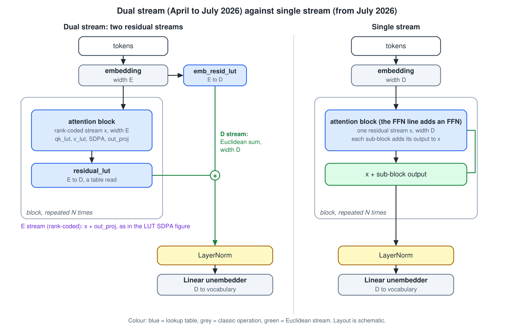

# Permutational transformers

A transformer in which every decision is based only on the rankings of vectors, with no real magnitudes passing between blocks. This follows the pure permutational line of the *Spiking Manifesto*: what a spiking population computes is the mapping from the order of its input spikes to the order of its output spikes, so the model should read orders and write orders. The line was worked on mainly in April and May 2026, overlapping with [LUT attention](lut-attention.md), and ended with a compromise: magnitudes are allowed at a few interfaces, and a second, Euclidean residual stream (the dual stream) carries them.

**Scales.** The pure line started at byte level (vocabulary 257; context 32, then 128) and moved on 2026-04-29 to the NanoChat BPE setting with vocabulary 32768 and context 512 (the fast test scale of [Transformers](README.md)). All numbers on this page are old-evaluation numbers of [`CONVENTIONS.md`](../../CONVENTIONS.md), single seeds, comparable only inside their own batch of runs. Byte-level numbers are validation cross-entropy (nats), BPE numbers are bits per byte.

## Idea / model

The article of the series ([article_v2](https://github.com/anatoli-starostin/spiky/blob/e85a5ceca156e79d199b0f6b395aa8e7e4ee287a/claude-memory/secondary/papers/Permutations-is-all-you-need/paper/article_v2.tex#L35-L37), byte level, context 128) states the premise literally: every learned operation depends only on the relative order of its inputs. Three substitutions follow: summation becomes concatenation, cosine similarity becomes a Kendall correlation, and a matrix multiplication becomes an aggregation of lookup-table reads indexed by pairwise sign comparisons.

**Rankings as sign vectors.** For a vector $x$ of $d$ coordinates, the dominance vector $\delta(x)$ has one entry per pair of coordinates $a<b$, equal to $+1$ if $x_a > x_b$ and $-1$ otherwise. It has $P = d(d-1)/2$ entries and records the full ranking of $x$ (it is the code the anchor-pair tables read, with all pairs as anchors). For two vectors $x$ and $y$ without ties, the Kendall correlation of their rankings is

$$\tau(x,y) = \frac{1}{P} \langle \delta(x), \delta(y)\rangle ,$$

the fraction of concordant pairs minus the fraction of discordant ones. Reading: the inner product of the two sign vectors, divided by $P$ because each has squared length $P$, is the cosine of the vectors and also their Kendall correlation. So attention scores between rankings can be computed by the usual scaled dot product on dominance vectors, and a score on $\pm 1$ vectors reduces to counting equal bits (an XOR and a popcount). Going back from a (possibly inconsistent) dominance vector to a vector is a Borda count (each coordinate sums its wins minus losses), and passing through it and back to signs projects onto realisable rankings.

**Building blocks** (all in the library, see Where it lives):

- *Ranking attention* ([`RankAttention`](https://github.com/anatoli-starostin/spiky/blob/e85a5ceca156e79d199b0f6b395aa8e7e4ee287a/src/spiky/lutorch/ranking_tools.py#L60-L175)): $Q$ and $K$ are tables, their outputs are turned into dominance vectors, and the scores are SDPA on these. [`BitAttention`](https://github.com/anatoli-starostin/spiky/blob/e85a5ceca156e79d199b0f6b395aa8e7e4ee287a/src/spiky/lutorch/bit_attention.py#L324-L361) is the same with $\pm 1$ operands, so the score is a popcount. [`RankWTAAttention`](https://github.com/anatoli-starostin/spiky/blob/e85a5ceca156e79d199b0f6b395aa8e7e4ee287a/src/spiky/lutorch/ranking_tools.py#L178-L325) takes the argmax instead of a softmax.
- *Rank projections* ([`VectorToDominance`](https://github.com/anatoli-starostin/spiky/blob/e85a5ceca156e79d199b0f6b395aa8e7e4ee287a/src/spiky/lutorch/ranking_tools.py#L605-L768), [`DominanceToVector`](https://github.com/anatoli-starostin/spiky/blob/e85a5ceca156e79d199b0f6b395aa8e7e4ee287a/src/spiky/lutorch/ranking_tools.py#L484-L522), [`DominanceCanonicalize`](https://github.com/anatoli-starostin/spiky/blob/e85a5ceca156e79d199b0f6b395aa8e7e4ee287a/src/spiky/lutorch/ranking_tools.py#L838-L862) = Borda, LayerNorm and back to signs, with a straight-through hard sign and a soft rank feature for the gradient): the interface between a block and the next, which strips magnitudes ("magnitude stripping").
- *Vote-based tables* ([`PermutationalLut`](https://github.com/anatoli-starostin/spiky/blob/e85a5ceca156e79d199b0f6b395aa8e7e4ee287a/src/spiky/lutorch/permutational_lut.py#L294-L669), [`BitPermutationLUT`](https://github.com/anatoli-starostin/spiky/blob/e85a5ceca156e79d199b0f6b395aa8e7e4ee287a/src/spiky/lutorch/bit_permutation_lut.py#L777-L920), [`MultiBitPermutationLUT`](https://github.com/anatoli-starostin/spiky/blob/e85a5ceca156e79d199b0f6b395aa8e7e4ee287a/src/spiky/lutorch/multi_bit_permutation_lut.py#L341-L443)): each table weight is a vote for a pairwise dominance relation instead of a real output; votes are scattered into a per-coordinate score whose ranking is the output. In `BitPermutationLUT` each weight is one bit; the multi-bit version has $K$ bits per weight.
- *Residuals and scale independence*: residuals were tried together with ranking and they work; the early byte-level rank-attention models (for example [`exp024`](https://github.com/anatoli-starostin/spiky/tree/e85a5ceca156e79d199b0f6b395aa8e7e4ee287a/transformer_exps/exp024_smooth_rank_norm)) have residual connections. The problem is of a different kind: a sum $x + y$ is not a function of the rankings of $x$ and $y$, so with residuals the network starts to learn specific magnitudes that do the flipping of the order, and the scheme stops being scale independent. The pure permutational line therefore drops residuals on purpose, and the memory note records the formal argument ([note](https://github.com/anatoli-starostin/spiky/blob/e85a5ceca156e79d199b0f6b395aa8e7e4ee287a/claude-memory/main-h100/memory-bank/project_permutational_architecture.md)).  A first no-residual LUT transformer exists already on 2026-01-05 ([file](https://github.com/anatoli-starostin/spiky/blob/86b689383525d490e726e9f3a528dcf81d08263e/src/spiky/lut/LUTTransformerNoResidualsExp.py)). Two ways of carrying information past a block were tried. *Summation*: the block output is added to a residual, either after rank canonicalisation or through a table that writes into the residual (for example [`exp084`](https://github.com/anatoli-starostin/spiky/tree/e85a5ceca156e79d199b0f6b395aa8e7e4ee287a/nanochat_exps/exp084_residual_luts), the same table that the dual stream later uses). *Concatenation*: the outputs of the blocks are not added but appended, so that the stream grows (DenseNet style, [`exp080`](https://github.com/anatoli-starostin/spiky/tree/e85a5ceca156e79d199b0f6b395aa8e7e4ee287a/nanochat_exps/exp080_concat_residuals), E=16 with 16 new coordinates per block), and in the no-residual models all layer outputs are concatenated into the unembedder. The maintainers consider concatenation the understudied one of the two.

  > **TODO (Architectures):** a like-for-like comparison of summation and concatenation in a permutational transformer is not recorded; it is an open question which of them costs less accuracy at equal parameters.

## What was found

**Byte level, context 128.** The article reports (claimed, old evaluation) that the first purely combinatorial transformer reaches validation cross-entropy 1.239 with 206M parameters against 1.203 for the dense model with 4.87M, and that with one-bit votes (`BitPermutationLUT`) it reaches 1.203, "matching the vanilla baseline", at 205M bit-parameters (about 25.6 MB packed) ([article](https://github.com/anatoli-starostin/spiky/blob/e85a5ceca156e79d199b0f6b395aa8e7e4ee287a/claude-memory/secondary/papers/Permutations-is-all-you-need/paper/article_v2.tex#L38-L41)). A later memory note says that another full-scale byte-level run at the same loss (1.2035, with an MLP unembedder) had magnitudes leaking into the unembedder. What this means, from the code of the two runs (their only difference is the added `out_canon` step, whose [comment](https://github.com/anatoli-starostin/spiky/blob/e85a5ceca156e79d199b0f6b395aa8e7e4ee287a/transformer_exps/exp390_exp377_full_scale/train.py#L122-L125) says the vote count would otherwise leak into the unembedder): the output table of a block produces for every pair of coordinates a vote count, a real number, and the block turns these counts into a vector by a Borda sum and a LayerNorm. Without a canonicalisation the size of each count survives this step, so the vector carries not only the order of the coordinates but also how strong each pairwise vote was, and the MLP unembedder, which reads the concatenated outputs of all blocks, can use these sizes to encode information. With the leak closed, by passing the pair votes through a hard $\pm 1$ sign before the Borda sum (a straight-through sign, so the gradient is still soft), only the order reaches the unembedder, and the same model gives 1.2166 ([note](https://github.com/anatoli-starostin/spiky/blob/e85a5ceca156e79d199b0f6b395aa8e7e4ee287a/claude-memory/main-h100/memory-bank/project_bitattention_matmulfree.md#full-scale-results-v257-100kbs32); run folders [exp370](https://github.com/anatoli-starostin/spiky/tree/e85a5ceca156e79d199b0f6b395aa8e7e4ee287a/transformer_exps/exp370_front2_graded_v_qk256_full_scale) and [exp390](https://github.com/anatoli-starostin/spiky/tree/e85a5ceca156e79d199b0f6b395aa8e7e4ee287a/transformer_exps/exp390_exp377_full_scale)). A wider leak-closed run with the same schedule, [`exp427`](https://github.com/anatoli-starostin/spiky/tree/e85a5ceca156e79d199b0f6b395aa8e7e4ee287a/transformer_exps/exp427_E64_sumpos_full) (64-wide embeddings), reached 1.1967. That is the same issue as the magnitude leakage discussed below, in a different place; we did not find which run produced the article's 1.203.

**Variants at context 32** (validation cross-entropy, run folders in [transformer_exps](https://github.com/anatoli-starostin/spiky/tree/e85a5ceca156e79d199b0f6b395aa8e7e4ee287a/transformer_exps)): the dense model is 1.3559. Plain SDPA attention on table-emitted queries and keys, with tables everywhere else, reached 1.4082 with 17.7M parameters and 1.3806 with 125.9M ([`exp207`](https://github.com/anatoli-starostin/spiky/tree/e85a5ceca156e79d199b0f6b395aa8e7e4ee287a/transformer_exps/exp207_rank_attn_optimal), [`exp225`](https://github.com/anatoli-starostin/spiky/tree/e85a5ceca156e79d199b0f6b395aa8e7e4ee287a/transformer_exps/exp225_nap10_tph128)); all projections as vote-based tables 1.5417 ([`exp280`](https://github.com/anatoli-starostin/spiky/tree/e85a5ceca156e79d199b0f6b395aa8e7e4ee287a/transformer_exps/exp280_full_perm)). A model with no float matrix multiplication at all (bit tables, `BitAttention`, a multi-bit logit table) reached 1.3721 at context 128 in a short run, 25k steps of batch 8, as an existence proof ([exp415](https://github.com/anatoli-starostin/spiky/tree/e85a5ceca156e79d199b0f6b395aa8e7e4ee287a/transformer_exps/exp415_multibit_logits)); the same model trained 12.5 times longer reached 1.2545 against 1.2166 for the matmul-using leak-closed model ([exp426](https://github.com/anatoli-starostin/spiky/tree/e85a5ceca156e79d199b0f6b395aa8e7e4ee287a/transformer_exps/exp426_multibit_full), note above). The existence proof is limited to vocabulary 257.

**Bit width of the votes** (byte level, context 128, 25k steps of batch 8, same shape, run folders linked): in the output (unembedder) table, 1-bit votes reached 1.4004, 2-bit 1.3905, 4-bit 1.3721 and 8-bit 1.4139 ([exp423](https://github.com/anatoli-starostin/spiky/tree/e85a5ceca156e79d199b0f6b395aa8e7e4ee287a/transformer_exps/exp423_bit_nap64), [exp424](https://github.com/anatoli-starostin/spiky/tree/e85a5ceca156e79d199b0f6b395aa8e7e4ee287a/transformer_exps/exp424_multibit_K2_nap64), [exp415](https://github.com/anatoli-starostin/spiky/tree/e85a5ceca156e79d199b0f6b395aa8e7e4ee287a/transformer_exps/exp415_multibit_logits), [exp425](https://github.com/anatoli-starostin/spiky/tree/e85a5ceca156e79d199b0f6b395aa8e7e4ee287a/transformer_exps/exp425_multibit_K8_nap64)); four bits was the best, the 8-bit run used a different scale and may not be a clean comparison. Inside the blocks the note records that queries, keys and values want crisp one-bit votes and the output projection graded ones: one-bit query, key and value tables with a 4-bit output projection ([`exp347`](https://github.com/anatoli-starostin/spiky/tree/e85a5ceca156e79d199b0f6b395aa8e7e4ee287a/transformer_exps/exp347_cfc_out_multibit_k4), 1.4322, "the best table-efficient setup") against all-4-bit ([`exp350`](https://github.com/anatoli-starostin/spiky/tree/e85a5ceca156e79d199b0f6b395aa8e7e4ee287a/transformer_exps/exp350_cfc_all_multibit_k4_qktph64), 1.4918) ([exp347](https://github.com/anatoli-starostin/spiky/tree/e85a5ceca156e79d199b0f6b395aa8e7e4ee287a/transformer_exps/exp347_cfc_out_multibit_k4), [exp350](https://github.com/anatoli-starostin/spiky/tree/e85a5ceca156e79d199b0f6b395aa8e7e4ee287a/transformer_exps/exp350_cfc_all_multibit_k4_qktph64), note above). The all-one-bit model of the same series ([`exp329`](https://github.com/anatoli-starostin/spiky/tree/e85a5ceca156e79d199b0f6b395aa8e7e4ee287a/transformer_exps/exp329_cfc), 1.3787) is better than both, with more bits of storage; the comparisons were not run with identical budgets. A corrected comparison against the dense baseline on the fixed evaluation was never run for bit tables.

**BPE port, single stream (2026-04-29 to 05-12).** The same design on the NanoChat data was far behind the dense model: 1.6598 for ranking attention with 6 heads and 48k steps ([`exp039`](https://github.com/anatoli-starostin/spiky/tree/e85a5ceca156e79d199b0f6b395aa8e7e4ee287a/nanochat_exps/exp039_dqk32_heads6_48k)) against 1.3406 for the dense model ([`exp041`](https://github.com/anatoli-starostin/spiky/tree/e85a5ceca156e79d199b0f6b395aa8e7e4ee287a/nanochat_exps/exp041_vanilla_48k), 23.4M parameters), and 1.6284 for the best one, `BitAttention` with a big unembedder ([`exp183`](https://github.com/anatoli-starostin/spiky/tree/e85a5ceca156e79d199b0f6b395aa8e7e4ee287a/nanochat_exps/exp183_e96_bigunembed_bitattn), 302M parameters) ([exp039](https://github.com/anatoli-starostin/spiky/tree/e85a5ceca156e79d199b0f6b395aa8e7e4ee287a/nanochat_exps/exp039_dqk32_heads6_48k), [exp041](https://github.com/anatoli-starostin/spiky/tree/e85a5ceca156e79d199b0f6b395aa8e7e4ee287a/nanochat_exps/exp041_vanilla_48k), [exp183](https://github.com/anatoli-starostin/spiky/tree/e85a5ceca156e79d199b0f6b395aa8e7e4ee287a/nanochat_exps/exp183_e96_bigunembed_bitattn)). Stripping magnitudes at every block output (a Borda projection and back to signs after the output projection, so that the path to the unembedder is ranking-only) gave 1.7088 ([`exp071`](https://github.com/anatoli-starostin/spiky/tree/e85a5ceca156e79d199b0f6b395aa8e7e4ee287a/nanochat_exps/exp071_canonicalize_out)) ([exp071](https://github.com/anatoli-starostin/spiky/tree/e85a5ceca156e79d199b0f6b395aa8e7e4ee287a/nanochat_exps/exp071_canonicalize_out)).

**Keeping the strategy or not.** A memory note records that the goal was "purely ranking-coded", and that recipes that dropped the canonicalisation or fed raw real-valued Q and K to SDPA scored better empirically "but are off-strategy" ([note](https://github.com/anatoli-starostin/spiky/blob/e85a5ceca156e79d199b0f6b395aa8e7e4ee287a/claude-memory/secondary/memory-bank/feedback_purely_ranking_coded.md)). The run folders agree: with no canonicalisation 1.6042 against 1.6212 at 8k steps and 1.4803 against 1.4906 at 48k ([`exp236`](https://github.com/anatoli-starostin/spiky/tree/e85a5ceca156e79d199b0f6b395aa8e7e4ee287a/nanochat_exps/exp236_no_rank_canon), [`exp237`](https://github.com/anatoli-starostin/spiky/tree/e85a5ceca156e79d199b0f6b395aa8e7e4ee287a/nanochat_exps/exp237_no_rank_canon_48k); the "with canonicalisation" numbers are the ones quoted in the configs) ([exp236](https://github.com/anatoli-starostin/spiky/tree/e85a5ceca156e79d199b0f6b395aa8e7e4ee287a/nanochat_exps/exp236_no_rank_canon), [exp237](https://github.com/anatoli-starostin/spiky/tree/e85a5ceca156e79d199b0f6b395aa8e7e4ee287a/nanochat_exps/exp237_no_rank_canon_48k)). The next step, raw SDPA on the real-valued output of the Q and K tables, is [LUT SDPA](lut-attention.md#lut-sdpa), which became the main line; the permutational idea survives there as the reading of the input by sign comparisons, and in the June design it is confined to the Q and K interface and a rank-coded stream.

**The permutational idea inside the FFN, once more.** In October 2026 a hard dominance layer in front of the hard layer of a LUT feed-forward was worse by 0.0478 (4k steps, one seed) and 43% slower per step ([FFN replacement](ffn-replacement.md#5-lutorch_ex-cartridges-on-the-full-corpus-october-2026)).

## The dual stream

A model whose residual stream is a ranking has no residual sum, but the classifier needs magnitudes and a stream that accumulates the contributions of all layers. The dual stream resolves this by keeping two streams side by side: the permutational stream, which every table reads (always behind a norm, so only the order matters) and which only the output tables of the attention blocks write to; and a parallel Euclidean stream of higher dimension that sums contributions by ordinary addition and feeds the linear unembedder. The motivation, as the maintainers describe it, is that a residual stream needs a high dimension, while the permutational stream was narrow (32 to 96 coordinates in the early versions); the June report gives a different reason (below).

- *Origin, byte level (April 2026).* [`exp250`](https://github.com/anatoli-starostin/spiky/tree/e85a5ceca156e79d199b0f6b395aa8e7e4ee287a/transformer_exps/exp250_dual_stream): a permutational stream of 32 coordinates with no residuals plus a vanilla residual stream of 256 ("MLP projection 32 to 128 to ReLU to 256 per layer"), 1.4001 with 53.0M parameters at context 32 ([run](https://github.com/anatoli-starostin/spiky/tree/e85a5ceca156e79d199b0f6b395aa8e7e4ee287a/transformer_exps/exp250_dual_stream)). The next experiments went back to one stream with concatenated layer outputs.
- *BPE port (2026-05-12).* The first BPE models concatenated the outputs of all blocks and read them with a big MLP unembedder, which dominated the weight bandwidth per token. [`exp272`](https://github.com/anatoli-starostin/spiky/tree/e85a5ceca156e79d199b0f6b395aa8e7e4ee287a/nanochat_exps/exp272_dual_stream_residual_lut) removed it. The permutational (rank) stream, 96 coordinates and later 64, is read only by the tables. Each block also passes its normalised output through one more table, [`residual_lut`](https://github.com/anatoli-starostin/spiky/blob/e85a5ceca156e79d199b0f6b395aa8e7e4ee287a/nanochat_exps/exp272_dual_stream_residual_lut/train.py), which maps it to 384 coordinates and adds the result into the Euclidean stream; a linear unembedder reads that stream. Validation bits per byte: 1.6836 with 368M parameters ([`exp272`](https://github.com/anatoli-starostin/spiky/tree/e85a5ceca156e79d199b0f6b395aa8e7e4ee287a/nanochat_exps/exp272_dual_stream_residual_lut)), and 1.6509 with 602M ([`exp303`](https://github.com/anatoli-starostin/spiky/tree/e85a5ceca156e79d199b0f6b395aa8e7e4ee287a/nanochat_exps/exp303_resid_tph2048_only)), where the `residual_lut` tables are made wider.
- *A residual on the rank stream (2026-05-17).* Until then, in the dual-stream models of the previous bullet ([`exp272`](https://github.com/anatoli-starostin/spiky/tree/e85a5ceca156e79d199b0f6b395aa8e7e4ee287a/nanochat_exps/exp272_dual_stream_residual_lut) and its descendants, including the baseline [`exp365`](https://github.com/anatoli-starostin/spiky/tree/e85a5ceca156e79d199b0f6b395aa8e7e4ee287a/nanochat_exps/exp365_bs16_weight_track) below), the rank stream had no residual: the output of each block, after a LayerNorm, simply replaced the block input, so only the Euclidean stream accumulated sums. [`exp418`](https://github.com/anatoli-starostin/spiky/tree/e85a5ceca156e79d199b0f6b395aa8e7e4ee287a/nanochat_exps/exp418_e_residual_bs16) added one, so that the next input is the sum of the old input and the block output, with a LayerNorm in front of the tables (pre-norm), so the tables still see only a normalised vector. At the same parameters (43.06M), batch size 16 and 8k steps this changed 1.6215 ([`exp365`](https://github.com/anatoli-starostin/spiky/tree/e85a5ceca156e79d199b0f6b395aa8e7e4ee287a/nanochat_exps/exp365_bs16_weight_track)) to 1.5611, an improvement of about 0.060, and the journey note calls it the biggest single architectural jump ([note](https://github.com/anatoli-starostin/spiky/blob/e85a5ceca156e79d199b0f6b395aa8e7e4ee287a/claude-memory/main-h100/memory-bank/project_e_stream_residual_arch_win.md), [journey](https://github.com/anatoli-starostin/spiky/blob/3ac72cca40c63b77d509d4ccff33bb85d43e515e/claude/experiment-journey.md)). The motivation in the note: in the previous checkpoint the output tables of the last layers were almost dead (97% of the rows of the last layer were never selected), and the suspected reason was that the gradient had to pass through a chain of hard lookups, with nothing to carry it past them. This is the summation residual discussed above, made acceptable by the norm in front of every table; these models are smaller than [`exp272`](https://github.com/anatoli-starostin/spiky/tree/e85a5ceca156e79d199b0f6b395aa8e7e4ee287a/nanochat_exps/exp272_dual_stream_residual_lut), so the two numbers are not comparable.
- *June 2026 report (LUTGPT).* Both streams have the same width (384) and the report states the split is "not for capacity" but structural: the backbone wants ranks and the classifier wants magnitudes. A narrower rank stream (192) costs about 0.02 bits per byte ([LUT attention](lut-attention.md#what-was-found-with-lut-sdpa-bpe-context-512-vocabulary-32768) has the numbers and the caveats); the model has no FFN and a linear unembedder.
- *Removal (July 2026).* A test on the hyperplane recipe replaced the two streams by one residual stream (no emb_resid_lut, no residual_lut, one stream, a LayerNorm before the unembedder): 1.2065 and 1.2034 against 1.1949 for the dual-stream model, so about 0.009 to 0.012 bits per byte worse, old evaluation, one seed ([exp023](https://github.com/anatoli-starostin/spiky/blob/0c35e3be8deab30338681013158ecbd166548764/experiments/hyperplane_ffn/exp023_singlestream_linear_unembedder/summary.json), [exp024](https://github.com/anatoli-starostin/spiky/blob/0c35e3be8deab30338681013158ecbd166548764/experiments/hyperplane_ffn/exp024_singlestream_linear_anchorinit/summary.json), [exp010](https://github.com/anatoli-starostin/spiky/blob/0c35e3be8deab30338681013158ecbd166548764/experiments/hyperplane_ffn/exp010_hyperplane_full_model_16k/summary.json)). The small difference and the simpler model made the single stream the standard; every model from August 2026 is single stream ([FFN replacement](ffn-replacement.md#3-the-dual-stream-is-removed-july-2026)).

The June report is `doc/lutorch/lutgpt_research_report.pdf` in Spiky main ([link](https://github.com/anatoli-starostin/spiky/blob/3ac72cca40c63b77d509d4ccff33bb85d43e515e/doc/lutorch/lutgpt_research_report.pdf)); its appendix names a branch `publish/lutgpt` that does not exist, which is a mistake in the report: everything it describes is in Spiky main.

## Magnitude leakage

*Leakage* is the use of real magnitudes to carry information on the forward path of a model that was meant to use only orders. The term was used only in this series of experiments. The article lists where it enters even a model that looks purely combinatorial: the real-valued sum of the table outputs inside a table, dot-product attention, and residual sums ([article](https://github.com/anatoli-starostin/spiky/blob/e85a5ceca156e79d199b0f6b395aa8e7e4ee287a/claude-memory/secondary/papers/Permutations-is-all-you-need/paper/article_v2.tex#L157-L182), section on magnitude leakage). The unembedder case on the byte-level page above is one more. Leaks matter for two reasons: they make the model depend on floating-point resolution instead of on order structure, and they make it impossible to replace the real arithmetic by lookups of ranks.

The experiments of this section ask one question: *how much does the model gain from magnitudes, where does it use them, and does the gain survive when they are removed?* The notes answer it in three steps.

**Step 1: removing magnitudes between blocks makes the model worse.** The block output was passed through a rank canonicalisation (the Borda projection and back to pair signs of plus or minus one), which keeps only the order of the coordinates. Replacing it by a plain LayerNorm, so that the output keeps its magnitudes, improved the BPE model: [`exp236`](https://github.com/anatoli-starostin/spiky/tree/e85a5ceca156e79d199b0f6b395aa8e7e4ee287a/nanochat_exps/exp236_no_rank_canon) reached 1.6042 against 1.6212 for its parent [`exp234`](https://github.com/anatoli-starostin/spiky/tree/e85a5ceca156e79d199b0f6b395aa8e7e4ee287a/nanochat_exps/exp234_dv32) at 8k steps, and [`exp237`](https://github.com/anatoli-starostin/spiky/tree/e85a5ceca156e79d199b0f6b395aa8e7e4ee287a/nanochat_exps/exp237_no_rank_canon_48k) 1.4803 against 1.4906 at 48k steps (358M parameters, the "with canonicalisation" numbers are those quoted in the configs). On bytes the leak fix of the previous section cost 0.013 in the same direction. So in both series the models do better with magnitudes, and the canonicalisation was dropped.

**Step 2: inside the tables, soft magnitudes help a little and cannot be hardened.** A table address is built from pair signs. The *hard* sign keeps only the order: it is plus or minus one according to whether $x_a$ is larger than $x_b$. The *soft* sign is a bounded function of the difference $d = x_a - x_b$, namely $p = d / (T + |d|)$ with a temperature $T$, so it also keeps how large the difference was; the softmax then mixes the table rows by their match scores. Two runs of the same BPE model (89.4M parameters, 8k steps, validation bits per byte) show the effect:

- hard argmax, one row per lookup ([`exp475`](https://github.com/anatoli-starostin/spiky/tree/e85a5ceca156e79d199b0f6b395aa8e7e4ee287a/nanochat_exps/exp475_meanabs_nocenter)): 1.4962. This is the honest number for the question "how good is a pure lookup";
- soft signs with softmax mixing ([`exp493`](https://github.com/anatoli-starostin/spiky/tree/e85a5ceca156e79d199b0f6b395aa8e7e4ee287a/nanochat_exps/exp493_matmul_softmax)): 1.4806, better by about 0.016;

A probe of the trained soft model shows that it uses the magnitudes: the magnitudes of its sign values were spread almost uniformly up to 0.7 and never saturated (no module had a value above 0.9), and the learned temperature never went to zero. The model is still a lookup model, only a smoother one, with a discontinuous choice of table rows. But its small gain over the hard model is bought with magnitudes that do not survive a plain switch to hard signs (the note reads this as a model that cannot be hardened; later results in Step 3 show that the gain can be moved into a few modules) ([note](https://github.com/anatoli-starostin/spiky/blob/e85a5ceca156e79d199b0f6b395aa8e7e4ee287a/claude-memory/main-h100/memory-bank/project_magnitude_leakage_softmax_package.md), [hard_sign in tiny_multi_head_lut.py](https://github.com/anatoli-starostin/spiky/blob/e85a5ceca156e79d199b0f6b395aa8e7e4ee287a/src/spiky/lutorch/tiny_multi_head_lut.py#L98-L107)).

Odd variants: hard signs with a soft mixing, other gates, hard signs in the backward pass

- hard signs with the same softmax mixing ([`exp500`](https://github.com/anatoli-starostin/spiky/tree/e85a5ceca156e79d199b0f6b395aa8e7e4ee287a/nanochat_exps/exp500_matmul_softmax_ste)): 1.5437, worse than both. With hard signs the neighbour row one bit away is an independently learned entry, so mixing it in is noise; the mixing helps only as the readout of a continuous coordinate. The same holds for the other gates tried with hard signs (a ReLU, a LayerNorm, polynomial ones, 1.64 to 1.66 or worse, [`exp501`](https://github.com/anatoli-starostin/spiky/tree/e85a5ceca156e79d199b0f6b395aa8e7e4ee287a/nanochat_exps/exp501_matmul_relunorm_hardsign) and [`exp502`](https://github.com/anatoli-starostin/spiky/tree/e85a5ceca156e79d199b0f6b395aa8e7e4ee287a/nanochat_exps/exp502_matmul_layernorm_hardsign)): none beat the argmax model;
- the argmax model whose backward pass also uses hard signs instead of the soft magnitudes ([`exp506`](https://github.com/anatoli-starostin/spiky/tree/e85a5ceca156e79d199b0f6b395aa8e7e4ee287a/nanochat_exps/exp506_hard_sign_bwd), claimed in the note, no summary file): about 0.04 worse than [`exp475`](https://github.com/anatoli-starostin/spiky/tree/e85a5ceca156e79d199b0f6b395aa8e7e4ee287a/nanochat_exps/exp475_meanabs_nocenter), whose forward pass is identical, so the soft magnitudes in the backward pass help as gradient shaping, modestly.

**Step 3: the gain is in the attention input, and a later sweep removed most of it.** Making only the Q, K, V tables soft and leaving the value, output and residual tables hard ([`exp507`](https://github.com/anatoli-starostin/spiky/tree/e85a5ceca156e79d199b0f6b395aa8e7e4ee287a/nanochat_exps/exp507_hybrid_qkv_soft)) gave 1.4797, equal to the all-soft model, with only 21.2M of the 89.4M parameters soft. Among the soft parts the value branch is worth about 0.004 ([`exp508`](https://github.com/anatoli-starostin/spiky/tree/e85a5ceca156e79d199b0f6b395aa8e7e4ee287a/nanochat_exps/exp508_qk_only_vtph320): 1.4840 against 1.4797 at matched capacity), and a dense linear readout of the dominance features in place of the tables stayed 0.055 to 0.09 behind ([note](https://github.com/anatoli-starostin/spiky/blob/e85a5ceca156e79d199b0f6b395aa8e7e4ee287a/claude-memory/main-h100/memory-bank/project_hybrid_qkv_soft_localization.md)). Later a sweep of table shapes made hard Q and K tables with 4 address bits (1.4825) slightly better than soft ones (1.4840), so the soft gain is not needed at this scale; the difference is inside the noise band of the sweep ([shape rules](https://github.com/anatoli-starostin/spiky/blob/e85a5ceca156e79d199b0f6b395aa8e7e4ee287a/claude-memory/main-h100/memory-bank/project_matmul_free_lut_shape_rules.md)).

**What is and is not shown.** Together: magnitudes help in every place where they were tested on BPE, by small amounts (about 0.01 to 0.02 bits per byte), the gain is concentrated at the attention input, and the soft-model part of it cannot be turned into pure lookups. There is no clean ablation of the magnitude hypothesis itself: [`exp493`](https://github.com/anatoli-starostin/spiky/tree/e85a5ceca156e79d199b0f6b395aa8e7e4ee287a/nanochat_exps/exp493_matmul_softmax) against the argmax model is confounded by the soft forward and by the optimiser (the all-soft runs used AdamW, the argmax ones Lion).

## Dead ends

- **Rank-faithful single-stream models on BPE data**: far behind the dense model, and the more faithful variants were worse ([exp071](https://github.com/anatoli-starostin/spiky/tree/e85a5ceca156e79d199b0f6b395aa8e7e4ee287a/nanochat_exps/exp071_canonicalize_out), [exp236](https://github.com/anatoli-starostin/spiky/tree/e85a5ceca156e79d199b0f6b395aa8e7e4ee287a/nanochat_exps/exp236_no_rank_canon)).
- **Soft signs hardened after training, and hard signs with a soft mix** (above).
- **Smooth ranking attention**: the model learned to exploit continuous rank values, 1.626 evaluated soft and about 2.57 evaluated hard, so it cannot be used for inference ([`exp088`](https://github.com/anatoli-starostin/spiky/tree/e85a5ceca156e79d199b0f6b395aa8e7e4ee287a/transformer_exps/exp088_dv16_rank_smooth), [SUMMARY](https://github.com/anatoli-starostin/spiky/blob/e85a5ceca156e79d199b0f6b395aa8e7e4ee287a/transformer_exps/SUMMARY.md#phase-7-attention-variants-exp085088)).

## Open ideas

- **Position in a pure ranking model.** RoPE needs a real inner product and works only with SDPA; we know of no analogue for rank-only attention (see [Positional encodings](positional-encodings.md#open-ideas)).
- **Matmul-free end to end at large vocabulary**: the byte-level existence proof stops at vocabulary 257; the memory note puts the training memory of a 32768-way logit table at 11.6 GiB with 4-bit votes, as an engineering problem ([note](https://github.com/anatoli-starostin/spiky/blob/e85a5ceca156e79d199b0f6b395aa8e7e4ee287a/claude-memory/main-h100/memory-bank/project_bitattention_matmulfree.md#scaling-to-large-vocab-v--32k)).
- **Recursive setups**, where a block is applied repeatedly: an open area that has not been started in this line; the isolated byte-level attempt is on [Other ideas](../other-ideas.md#the-byte-level-recursivemultiheadlut-april-2026).

## Where it lives

All links are pinned to commits of [`anatoli-starostin/spiky`](https://github.com/anatoli-starostin/spiky).

| What | Link |
| --- | --- |
| [`RankAttention`](https://github.com/anatoli-starostin/spiky/blob/e85a5ceca156e79d199b0f6b395aa8e7e4ee287a/src/spiky/lutorch/ranking_tools.py#L60-L175), [`RankWTAAttention`](https://github.com/anatoli-starostin/spiky/blob/e85a5ceca156e79d199b0f6b395aa8e7e4ee287a/src/spiky/lutorch/ranking_tools.py#L178-L325), [`VectorToDominance`](https://github.com/anatoli-starostin/spiky/blob/e85a5ceca156e79d199b0f6b395aa8e7e4ee287a/src/spiky/lutorch/ranking_tools.py#L605-L768), [`DominanceToVector`](https://github.com/anatoli-starostin/spiky/blob/e85a5ceca156e79d199b0f6b395aa8e7e4ee287a/src/spiky/lutorch/ranking_tools.py#L484-L522), [`DominanceCanonicalize`](https://github.com/anatoli-starostin/spiky/blob/e85a5ceca156e79d199b0f6b395aa8e7e4ee287a/src/spiky/lutorch/ranking_tools.py#L838-L862), [`PositionalPermutation`](https://github.com/anatoli-starostin/spiky/blob/e85a5ceca156e79d199b0f6b395aa8e7e4ee287a/src/spiky/lutorch/ranking_tools.py#L427-L449) | [ranking_tools.py](https://github.com/anatoli-starostin/spiky/blob/e85a5ceca156e79d199b0f6b395aa8e7e4ee287a/src/spiky/lutorch/ranking_tools.py) |
| [`BitAttention`](https://github.com/anatoli-starostin/spiky/blob/e85a5ceca156e79d199b0f6b395aa8e7e4ee287a/src/spiky/lutorch/bit_attention.py#L324-L361) | [bit_attention.py](https://github.com/anatoli-starostin/spiky/blob/e85a5ceca156e79d199b0f6b395aa8e7e4ee287a/src/spiky/lutorch/bit_attention.py) |
| vote-based tables | [permutational_lut.py](https://github.com/anatoli-starostin/spiky/blob/e85a5ceca156e79d199b0f6b395aa8e7e4ee287a/src/spiky/lutorch/permutational_lut.py), [bit_permutation_lut.py](https://github.com/anatoli-starostin/spiky/blob/e85a5ceca156e79d199b0f6b395aa8e7e4ee287a/src/spiky/lutorch/bit_permutation_lut.py), [multi_bit_permutation_lut.py](https://github.com/anatoli-starostin/spiky/blob/e85a5ceca156e79d199b0f6b395aa8e7e4ee287a/src/spiky/lutorch/multi_bit_permutation_lut.py), [rank_quantize.py](https://github.com/anatoli-starostin/spiky/blob/e85a5ceca156e79d199b0f6b395aa8e7e4ee287a/src/spiky/lutorch/rank_quantize.py) |
| the BPE-era table primitive and the `hard_sign` option | [tiny_multi_head_lut.py](https://github.com/anatoli-starostin/spiky/blob/e85a5ceca156e79d199b0f6b395aa8e7e4ee287a/src/spiky/lutorch/tiny_multi_head_lut.py) |
| fully permutational notebook (2026-04-16) | [lutorch_perm_transformer.ipynb](https://github.com/anatoli-starostin/spiky/blob/e85a5ceca156e79d199b0f6b395aa8e7e4ee287a/workbooks/lutorch_perm_transformer.ipynb) |
| articles and reports | [article.tex](https://github.com/anatoli-starostin/spiky/blob/e85a5ceca156e79d199b0f6b395aa8e7e4ee287a/claude-memory/secondary/papers/Permutations-is-all-you-need/paper/article.tex), [article_v2.tex](https://github.com/anatoli-starostin/spiky/blob/e85a5ceca156e79d199b0f6b395aa8e7e4ee287a/claude-memory/secondary/papers/Permutations-is-all-you-need/paper/article_v2.tex), [status_report_2026-05.tex](https://github.com/anatoli-starostin/spiky/blob/e85a5ceca156e79d199b0f6b395aa8e7e4ee287a/claude-memory/secondary/papers/Permutations-is-all-you-need/paper/status_report_2026-05.tex), [lutgpt_research_report.pdf](https://github.com/anatoli-starostin/spiky/blob/3ac72cca40c63b77d509d4ccff33bb85d43e515e/doc/lutorch/lutgpt_research_report.pdf) |
| experiment families | [transformer_exps](https://github.com/anatoli-starostin/spiky/tree/e85a5ceca156e79d199b0f6b395aa8e7e4ee287a/transformer_exps) (byte level), [nanochat_exps](https://github.com/anatoli-starostin/spiky/tree/e85a5ceca156e79d199b0f6b395aa8e7e4ee287a/nanochat_exps) (BPE) |
| dominance stack in the FFN | [dominance_stack](https://github.com/anatoli-starostin/spiky/tree/c7fdbf4a06c72e15da546a641e07e08dda187221/experiments/lutorch_ex_fused/dominance_stack) |

The dual-stream diagram is generated by [`figures/make_figures.py`](../figures/make_figures.py). Run folders use experiment names; byte-level and BPE numbers collide, so the folder is always named.
