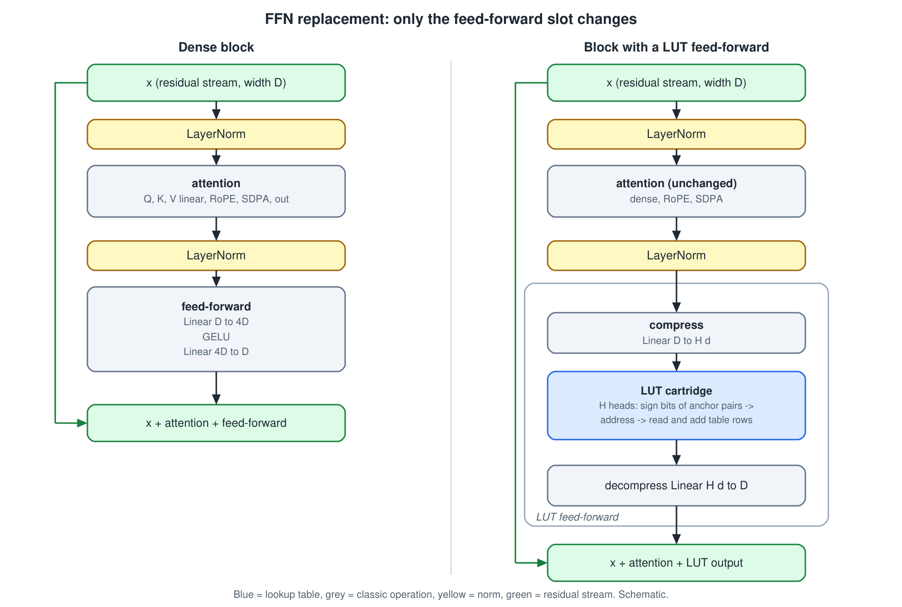

# FFN replacement

A classic transformer (dense scaled-dot-product attention, RoPE, wide embeddings, a dense untied output layer) in which only the feed-forward block is replaced by lookup tables. This is the line that reached GPT-2 scale, and the line the current full-scale NanoChat work continues. At the small scale the LUT feed-forward comes close to the dense one and in some sweeps passes it; at GPT-2 scale the LUT models we have so far are behind the dense baseline in loss and in speed. This says that we have not yet found the right architecture, not that a LUT feed-forward cannot match a dense one.

**Scales.** Every number below says which of these it was measured at.

| Name | Context | Vocabulary | Model | Used for |
| --- | --- | --- | --- | --- |
| fast test scale | 512 | 32768 | 6 layers, width 384, 6 heads, 35.79M parameters when dense; 16k steps of 24,576 tokens are about 393M tokens | most hypotheses; every sweep of the small-scale part |
| GPT-2 scale (d24 NanoChat) | 2048 | 32768 | 24 layers, 1.38B parameters when dense, global batch 2^20 tokens, 5,568 steps on one H100 | the full-scale comparison with the dense model ([run config](https://github.com/anatoli-starostin/spiky/blob/b38b57d70f4c30f877888ac148f9d9e60495b00d/experiments/lut_nanochat/results/d24-lutffn-confn1-1xh100-s0-full-v2/run_config.json)) |

**Three evaluations.** Numbers from the first part are from the *old evaluation* of [`CONVENTIONS.md`](../../../CONVENTIONS.md) (the validation window depended on the training batch size) and are comparable only inside their own batch of runs. From the fixed evaluation on (batch 48 times 100 steps, 12 leading rows skipped, 2,451,456 held-out tokens, [FIXED_EVAL.md](https://github.com/anatoli-starostin/spiky/blob/c4a750b2f9ab65efe6a61254103a92d6fd8fc2a2/experiments/ffn_replacement/FIXED_EVAL.md#the-fix)) numbers are comparable across runs. The d24 numbers use the native evaluation of NanoChat. The training corpus also changes: ClimbMix with 4 local training shards (about 213M tokens, so about five passes in a 48k-step run) in the September runs, and the full 170 shards (less than one pass) in the October fused sweep and at d24.

## Idea / model

The dense feed-forward maps the width $D$ to $4D$ and back. The LUT feed-forward replaces it by three steps (the wrapper is called [`ProjectionMHL`](https://github.com/anatoli-starostin/spiky/blob/3ac72cca40c63b77d509d4ccff33bb85d43e515e/src/spiky/lutorch_ex/projection.py#L69-L273) in [`lutorch_ex`](https://github.com/anatoli-starostin/spiky/tree/3ac72cca40c63b77d509d4ccff33bb85d43e515e/src/spiky/lutorch_ex) and [`CompressionMHL`](https://github.com/anatoli-starostin/spiky/blob/3ac72cca40c63b77d509d4ccff33bb85d43e515e/src/spiky/lutorch/compression_mhl.py#L59-L258) in the earlier code):

1. **compress** with a dense linear map from $D$ to $H d$, where $H$ is the number of heads and $d$ the width each head works on;
2. **LUT**: each head reads $z$, a slice of $d$ numbers. For each of its tables it compares $n_\text{ap}$ pairs of coordinates (the anchor pairs), turns the signs $b_j=[z_{a_j}>z_{b_j}]$ into an address $c=\sum_j b_j 2^j$ with $2^{n_\text{ap}}$ possible values, and reads row $c$ of the table. The head output is the sum of the rows of its $t$ tables. Reading: the hard comparison picks one row of many; nothing is multiplied;
3. **decompress** with a dense linear map from $H d$ back to $D$.

The two linear maps stay dense, so the block still contains matrix multiplications: the LUT does the nonlinear part at a width ($H d$) much smaller than $4D$. The anchors, the number of tables $t$ (called `tph`) and the geometry are described on the [Primitives](../../lookup-table-primitives/README.md) pages ([Hashing](../../lookup-table-primitives/hashing.md), [Readout](../../lookup-table-primitives/readout.md), [Gradient backpropagation](../../lookup-table-primitives/backpropagation.md)).

The line follows the full-LUT models without an FFN ([LUT attention](lut-attention.md), [Permutational transformers](permutational.md)), which had several times the parameters of the dense baseline; the goal was to reach the dense loss at or under the dense parameter budget. A first LUT-in-vanilla run had been done in May ([`exp606`](https://github.com/anatoli-starostin/spiky/tree/e85a5ceca156e79d199b0f6b395aa8e7e4ee287a/nanochat_exps/exp606_vanilla_lut_ffn)).

## What was found

### 1. Routed feed-forward with compression, small scale (August 2026; old evaluation)

The first design that matched the dense baseline at the fast test scale. The paper ["Replacing Transformer Feed-Forward Layers with Lookup Tables"](https://github.com/anatoli-starostin/spiky/blob/3ac72cca40c63b77d509d4ccff33bb85d43e515e/experiments/ffn_replacement/paper/ffn_replacement.pdf) and its [README](https://github.com/anatoli-starostin/spiky/blob/3ac72cca40c63b77d509d4ccff33bb85d43e515e/experiments/ffn_replacement/README.md#the-23-runs) hold 23 runs. All numbers in this subsection are final validation bits per byte from `summary.json`, old evaluation, single seeds, 16k steps unless said.

- Untied dense baseline [`exp_n_0135`](https://github.com/anatoli-starostin/spiky/tree/3ac72cca40c63b77d509d4ccff33bb85d43e515e/experiments/ffn_replacement/runs/exp_n_0135_untied_vanilla_baseline_16k): 1.2014 with 35.79M parameters ([run](https://github.com/anatoli-starostin/spiky/tree/3ac72cca40c63b77d509d4ccff33bb85d43e515e/experiments/ffn_replacement/runs/exp_n_0135_untied_vanilla_baseline_16k)).
- The LUT with no projections (the tables read the full width, [`exp_n_0136`](https://github.com/anatoli-starostin/spiky/tree/3ac72cca40c63b77d509d4ccff33bb85d43e515e/experiments/ffn_replacement/runs/exp_n_0136_fastmhl_raw_H4_nap8_tph128)) reached 1.2057 with 330.7M parameters, so the direct replacement is level with the dense loss only at nine times the parameters ([run](https://github.com/anatoli-starostin/spiky/tree/3ac72cca40c63b77d509d4ccff33bb85d43e515e/experiments/ffn_replacement/runs/exp_n_0136_fastmhl_raw_H4_nap8_tph128)).
- Compressing the output only ([`exp_n_0138`](https://github.com/anatoli-starostin/spiky/tree/3ac72cca40c63b77d509d4ccff33bb85d43e515e/experiments/ffn_replacement/runs/exp_n_0138_outcompress_only_H4_nap8_tph128), 66.9M) reached 1.2125, which the current code does not reproduce bit for bit ([header](https://github.com/anatoli-starostin/spiky/blob/3ac72cca40c63b77d509d4ccff33bb85d43e515e/src/spiky/lutorch/compression_mhl.py#L31-L34)); compressing the input too, with 4 heads of width 48 and tables of 256 cells ([`exp_n_0121`](https://github.com/anatoli-starostin/spiky/tree/3ac72cca40c63b77d509d4ccff33bb85d43e515e/experiments/ffn_replacement/runs/exp_n_0121_ffnsw_nap8_tph128_16k), 67.4M), reached 1.1915 ([run](https://github.com/anatoli-starostin/spiky/tree/3ac72cca40c63b77d509d4ccff33bb85d43e515e/experiments/ffn_replacement/runs/exp_n_0121_ffnsw_nap8_tph128_16k)).
- The best of the grid, 9 anchor pairs (512 cells) and 256 tables per head with 180.6M parameters ([`exp_n_0118`](https://github.com/anatoli-starostin/spiky/tree/3ac72cca40c63b77d509d4ccff33bb85d43e515e/experiments/ffn_replacement/runs/exp_n_0118_ffnsw_S2a_nap9_FULL16k)), reached 1.1746, and the cheapest one that beat the dense baseline on the old evaluation, 7 anchor pairs and 128 tables with 48.5M parameters ([`exp_n_0127`](https://github.com/anatoli-starostin/spiky/tree/3ac72cca40c63b77d509d4ccff33bb85d43e515e/experiments/ffn_replacement/runs/exp_n_0127_grid_H4d48_nap7_tph128)), reached 1.1947 ([0118](https://github.com/anatoli-starostin/spiky/tree/3ac72cca40c63b77d509d4ccff33bb85d43e515e/experiments/ffn_replacement/runs/exp_n_0118_ffnsw_S2a_nap9_FULL16k), [0127](https://github.com/anatoli-starostin/spiky/tree/3ac72cca40c63b77d509d4ccff33bb85d43e515e/experiments/ffn_replacement/runs/exp_n_0127_grid_H4d48_nap7_tph128), [grid summary](https://github.com/anatoli-starostin/spiky/blob/3ac72cca40c63b77d509d4ccff33bb85d43e515e/experiments/ffn_replacement/FFN_GRID_SUMMARY.md)).
- Longer runs: at 48k steps the dense model reached 1.1514 and the 0127 geometry 1.1560; at 144k steps both reached 1.1480 ([0151](https://github.com/anatoli-starostin/spiky/tree/3ac72cca40c63b77d509d4ccff33bb85d43e515e/experiments/ffn_replacement/runs/exp_n_0151_long48k_untied_vanilla), [0155](https://github.com/anatoli-starostin/spiky/tree/3ac72cca40c63b77d509d4ccff33bb85d43e515e/experiments/ffn_replacement/runs/exp_n_0155_long48k_from_0127), [0157](https://github.com/anatoli-starostin/spiky/tree/3ac72cca40c63b77d509d4ccff33bb85d43e515e/experiments/ffn_replacement/runs/exp_n_0157_long144k_vanilla), [0158](https://github.com/anatoli-starostin/spiky/tree/3ac72cca40c63b77d509d4ccff33bb85d43e515e/experiments/ffn_replacement/runs/exp_n_0158_long144k_from_0127)).
- On speed, the paper reports that the tiny LUT feed-forward block runs 1.27 to 1.91 times faster than the dense one on an RTX 5090 and slower on an H100 (1.11 to 1.83 times the dense time) ([paper](https://github.com/anatoli-starostin/spiky/blob/3ac72cca40c63b77d509d4ccff33bb85d43e515e/experiments/ffn_replacement/paper/ffn_replacement.tex#L472-L477)).

Design lessons of the grid: the summary says not to starve the number of tables, and the projections in front and behind the LUT are worth their cost: the LUT without them needs many more parameters for the same loss, as [`exp_n_0136`](https://github.com/anatoli-starostin/spiky/tree/3ac72cca40c63b77d509d4ccff33bb85d43e515e/experiments/ffn_replacement/runs/exp_n_0136_fastmhl_raw_H4_nap8_tph128) and [`exp_n_0138`](https://github.com/anatoli-starostin/spiky/tree/3ac72cca40c63b77d509d4ccff33bb85d43e515e/experiments/ffn_replacement/runs/exp_n_0138_outcompress_only_H4_nap8_tph128) show against [`exp_n_0121`](https://github.com/anatoli-starostin/spiky/tree/3ac72cca40c63b77d509d4ccff33bb85d43e515e/experiments/ffn_replacement/runs/exp_n_0121_ffnsw_nap8_tph128_16k). The tables-against-cells comparison is repeated in the fixed evaluation below.

**The evaluation correction.** These parity claims were later shown to be partly an artefact of the evaluation: the LUT runs (device batch 12) had been scored on the first 61,440 validation tokens and the dense ones (device batch 48) on the first 245,760, which are different slices of the stream. Re-scoring the same checkpoints gave 1.1651 for the dense 16k run (was 1.2014), 1.1154 at 48k (was 1.1514), and 1.1114 at 144k (was 1.1480), against corrections of only 0.008 to 0.011 for the LUT runs, so several signs flipped; for example [`exp_n_0129`](https://github.com/anatoli-starostin/spiky/tree/c4a750b2f9ab65efe6a61254103a92d6fd8fc2a2/experiments/ffn_replacement/runs_corrected/exp_n_0129_grid_H4d48_nap8_tph256) was reported 0.020 below the dense model and is 0.006 above it ([survey, section 0](https://github.com/anatoli-starostin/spiky/blob/c4a750b2f9ab65efe6a61254103a92d6fd8fc2a2/experiments/ffn_replacement/runs_corrected/LIGHTMHL_SURVEY.md#0-the-bug-that-started-the-branch-and-the-fix)). The paper carries the old numbers.

The same pattern seems to apply to the June LUT SDPA report (device batch 24 for the LUT model, 48 for the dense one, ten evaluation micro-batches in both, see [LUT attention](lut-attention.md#what-was-found-with-lut-sdpa-bpe-context-512-vocabulary-32768)). We did not rescore those runs.

### 2. Learned and ternary routing instead of anchor pairs (July to September 2026; old evaluation)

The fixed anchor-pair comparison $z_a - z_b > 0$ can be replaced by a learned hyperplane $\langle w,z\rangle + \beta>0$ per probe, or by a ternary one with weights $-1$, $0$, $+1$ ([ternary page](../../lookup-table-primitives/ternary.md)). All numbers here are from `research/hyperplane_ffn_next`, old evaluation, single seeds, 16k steps, final validation bits per byte.

- With the whole model built from hyperplane tables (dual stream, 324.7M parameters) [`exp010`](https://github.com/anatoli-starostin/spiky/tree/0c35e3be8deab30338681013158ecbd166548764/experiments/hyperplane_ffn/exp010_hyperplane_full_model_16k) reached 1.1949 against 1.2014 for the dense baseline ([exp010](https://github.com/anatoli-starostin/spiky/blob/0c35e3be8deab30338681013158ecbd166548764/experiments/hyperplane_ffn/exp010_hyperplane_full_model_16k/summary.json)). With only the feed-forward replaced and hard reading it was 1.2326 ([`exp008`](https://github.com/anatoli-starostin/spiky/tree/0c35e3be8deab30338681013158ecbd166548764/experiments/hyperplane_ffn/exp008_hyperplane_mhl_ffn_nap6_tph512)), and with the two-row blend 1.2139 ([`exp009`](https://github.com/anatoli-starostin/spiky/tree/0c35e3be8deab30338681013158ecbd166548764/experiments/hyperplane_ffn/exp009_hyperplane_mhl_ffn_nap6_tph512_hybrid_smooth)), both with 6 anchor pairs and 512 tables ([exp008](https://github.com/anatoli-starostin/spiky/blob/0c35e3be8deab30338681013158ecbd166548764/experiments/hyperplane_ffn/exp008_hyperplane_mhl_ffn_nap6_tph512/summary.json), [exp009](https://github.com/anatoli-starostin/spiky/blob/0c35e3be8deab30338681013158ecbd166548764/experiments/hyperplane_ffn/exp009_hyperplane_mhl_ffn_nap6_tph512_hybrid_smooth/summary.json)).
- Learned against fixed anchors: in the 70M-parameter test the learned hyperplanes reached 1.2793 against 1.3110 for fixed anchors ([`exp014`](https://github.com/anatoli-starostin/spiky/tree/0c35e3be8deab30338681013158ecbd166548764/experiments/hyperplane_ffn/exp014_hyperplane_small_70m), [`exp015`](https://github.com/anatoli-starostin/spiky/tree/0c35e3be8deab30338681013158ecbd166548764/experiments/hyperplane_ffn/exp015_fixedanchor_small_70m)), and in the single-stream model (below) learned routing with anchor-pair initialisation reached 1.2034 against 1.2408 for the anchor-pair twin ([`exp024`](https://github.com/anatoli-starostin/spiky/tree/0c35e3be8deab30338681013158ecbd166548764/experiments/hyperplane_ffn/exp024_singlestream_linear_anchorinit), [`exp025`](https://github.com/anatoli-starostin/spiky/tree/0c35e3be8deab30338681013158ecbd166548764/experiments/hyperplane_ffn/exp025_singlestream_linear_fastmhl)), about 0.035 ([exp014](https://github.com/anatoli-starostin/spiky/blob/0c35e3be8deab30338681013158ecbd166548764/experiments/hyperplane_ffn/exp014_hyperplane_small_70m/summary.json), [exp015](https://github.com/anatoli-starostin/spiky/blob/0c35e3be8deab30338681013158ecbd166548764/experiments/hyperplane_ffn/exp015_fixedanchor_small_70m/summary.json), [exp024](https://github.com/anatoli-starostin/spiky/blob/0c35e3be8deab30338681013158ecbd166548764/experiments/hyperplane_ffn/exp024_singlestream_linear_anchorinit/summary.json), [exp025](https://github.com/anatoli-starostin/spiky/blob/0c35e3be8deab30338681013158ecbd166548764/experiments/hyperplane_ffn/exp025_singlestream_linear_fastmhl/summary.json)).
- The ternary one-axis-at-a-time sweep around [`exp_n_0134`](https://github.com/anatoli-starostin/spiky/tree/0c35e3be8deab30338681013158ecbd166548764/experiments/hyperplane_ffn/exp_n_0134_ternary_target192_FULL16k) (1.18943, 4 heads of width 48, 256-cell tables, 128 tables per head, 192 non-zero weights per hyperplane) found that every axis rewards capacity or freedom: 8 heads, 256 tables, 1024 cells and no sparsity penalty each lowered the loss by 0.002 to 0.008, and the first stacked point (8 heads, no penalty, [`exp_n_0149`](https://github.com/anatoli-starostin/spiky/tree/0c35e3be8deab30338681013158ecbd166548764/experiments/hyperplane_ffn/exp_n_0149_star_A2b_H8_nopenalty)) reached 1.18203. The sparsity hinge is a pure cost in loss at the full 16k schedule, growing as the target tightens (64 non-zeros: 1.2094; 128: 1.2046; 192: 1.1894; 256: 1.1885; none: 1.1876). It buys deployment density (about 172 non-zeros per hyperplane against 269 without it), so on loss alone denser wins ([sweep](https://github.com/anatoli-starostin/spiky/blob/0c35e3be8deab30338681013158ecbd166548764/experiments/hyperplane_ffn/TERNARY_16K_SWEEP.md)). The earlier reading from 4k-step runs, that sparsity was free, did not survive the full schedule.
- The branch's own README says the question is paused, not concluded ([README](https://github.com/anatoli-starostin/spiky/blob/0c35e3be8deab30338681013158ecbd166548764/experiments/hyperplane_ffn/README.md#L7)).

### 3. The dual stream is removed (July 2026)

See [Permutational transformers](permutational.md#the-dual-stream) for the dual stream. The switch to one residual stream, with the single-stream models of this branch, cost about 0.009 to 0.012 bits per byte in the A/B at 16k steps ([`exp023`](https://github.com/anatoli-starostin/spiky/tree/0c35e3be8deab30338681013158ecbd166548764/experiments/hyperplane_ffn/exp023_singlestream_linear_unembedder), [`exp024`](https://github.com/anatoli-starostin/spiky/tree/0c35e3be8deab30338681013158ecbd166548764/experiments/hyperplane_ffn/exp024_singlestream_linear_anchorinit) against [`exp010`](https://github.com/anatoli-starostin/spiky/tree/0c35e3be8deab30338681013158ecbd166548764/experiments/hyperplane_ffn/exp010_hyperplane_full_model_16k), old evaluation) and simplified the model, and every model from [`exp032`](https://github.com/anatoli-starostin/spiky/tree/0c35e3be8deab30338681013158ecbd166548764/experiments/hyperplane_ffn/exp032_fast_vanilla_baseline_4k) on (2026-08-15) is single stream ([exp023](https://github.com/anatoli-starostin/spiky/blob/0c35e3be8deab30338681013158ecbd166548764/experiments/hyperplane_ffn/exp023_singlestream_linear_unembedder/summary.json)).

### 4. Fixed evaluation, confidence forms, and parity that does not last (September 2026)

On the fixed evaluation the dense baseline is 1.1651 at 16k steps (a second seed gives 1.1618, so the seed spread is 0.0034), 1.1154 at 48k and 1.1114 at 144k ([survey](https://github.com/anatoli-starostin/spiky/blob/c4a750b2f9ab65efe6a61254103a92d6fd8fc2a2/experiments/ffn_replacement/runs_corrected/LIGHTMHL_SURVEY.md#baselines-used-throughout)).

The best forms came from a pure-autograd control layer, [`LightMultiHeadLUT`](https://github.com/anatoli-starostin/spiky/blob/c4a750b2f9ab65efe6a61254103a92d6fd8fc2a2/src/spiky/lutorch/light_multi_head_lut.py), inspired by the LookupFFN paper ([arXiv:2403.07221](https://arxiv.org/abs/2403.07221)): the gathered row is multiplied by a smooth per-table confidence score computed from the comparison margins, which is also the only path through which the routing receives a gradient (the [Readout](../../lookup-table-primitives/readout.md#23-confidence-score-forms) and [Gradient backpropagation](../../lookup-table-primitives/backpropagation.md#4-gradient-through-the-confidence-score) pages describe the forms). All numbers are fixed evaluation, single seeds, 4 heads of width 48, 6 layers, fast test scale, from the survey:

- The form of the score is the largest lever. The LookupFFN `margin` form (score proportional to the sum of the margins times the product of sigmoids) beats the `bounded_norm` form by 0.0346 bits per byte at equal geometry, which is about ten times the seed spread: 1.1729 against 1.2075 ([`exp_g_0193`](https://github.com/anatoli-starostin/spiky/tree/c4a750b2f9ab65efe6a61254103a92d6fd8fc2a2/experiments/ffn_replacement/runs_corrected/exp_g_0193_B16k_light_margin_tph128_noznorm_seed1), [`exp_g_0189`](https://github.com/anatoli-starostin/spiky/tree/c4a750b2f9ab65efe6a61254103a92d6fd8fc2a2/experiments/ffn_replacement/runs_corrected/exp_g_0189_B16k_light_bnorm_tph128_nodecay_seed1), 67.35M parameters).
- Tables beat cells at equal parameters: doubling the tables per head gained 0.0043 to 0.0053 more than doubling the cells per table, in two comparisons at different sizes, each about 1.3 and 1.6 seed spreads. At 48k steps the same comparison shrinks to 0.0018 and doubling cells alone is worth 0.0002.
- At 16k steps a run (105.1M parameters, 256 tables of 256 cells per head, [`exp_n_0196`](https://github.com/anatoli-starostin/spiky/tree/c4a750b2f9ab65efe6a61254103a92d6fd8fc2a2/experiments/ffn_replacement/runs_corrected/exp_n_0196_light_margin_znorm_nap8_tph256_seed1)) reached 1.1639, inside the two-seed band of the dense model, so it is a parity read.
- **At 48k steps the parity disappears for these two designs.** The same configuration trained for 48k steps ([`exp_n_0200`](https://github.com/anatoli-starostin/spiky/tree/c4a750b2f9ab65efe6a61254103a92d6fd8fc2a2/experiments/ffn_replacement/runs_corrected/exp_n_0200_light_margin_znorm_nap8_tph256_48k_seed1)) reached 1.1345 against 1.1154 for the dense model (+0.0191), and an entirely different LUT design, the [`FastMultiHeadLut`](https://github.com/anatoli-starostin/spiky/blob/3ac72cca40c63b77d509d4ccff33bb85d43e515e/src/spiky/lutorch/fast_multi_head_lut.py#L754-L1162) with the confidence off and 180.6M parameters ([`exp_n_0171`](https://github.com/anatoli-starostin/spiky/tree/c4a750b2f9ab65efe6a61254103a92d6fd8fc2a2/experiments/ffn_replacement/runs_corrected/exp_n_0171_0118at48k_compmhl_H4_nap9_tph256_in48_out48)), lands at +0.0191 as well. The dense model gains 1.69 times more from the longer schedule. The survey also finds that the value of added table budget shrinks with the schedule: about 0.008 bits per doubling at 16k and about 0.001 at 48k.
- The data regime may explain part of this. These September runs were trained on 4 shards (213M tokens looped for several epochs, [train corpus note](https://github.com/anatoli-starostin/spiky/blob/c4a750b2f9ab65efe6a61254103a92d6fd8fc2a2/experiments/ffn_replacement/lut_ablation/bpb_figures_4747/README.md)); the 170-shard sweep of the next section, in which the model sees less than one pass, has the best LUT slightly ahead of the dense model.

**The 21-run ablation of the LUT core module** (16k steps, fast test scale, fixed evaluation, single seeds, 4 heads, 128 tables, 8 anchor pairs, [lut_ablation README](https://github.com/anatoli-starostin/spiky/blob/c4a750b2f9ab65efe6a61254103a92d6fd8fc2a2/experiments/ffn_replacement/lut_ablation/README.md#the-21-runs); dense baseline 1.1651). With the total-variation penalty on neighbouring cells of a table off and on ([Regularisation](../../optimisation/regularisation.md#2-total-variation-penalties)):

| Layer | Forward and backward | Without TV | With TV |
| --- | --- | --- | --- |
| first generation [`MultiHeadLut`](https://github.com/anatoli-starostin/spiky/blob/e85a5ceca156e79d199b0f6b395aa8e7e4ee287a/src/spiky/lutorch/multi_head_lut.py#L161-L485), hard | one row | [1.1997](https://github.com/anatoli-starostin/spiky/tree/c4a750b2f9ab65efe6a61254103a92d6fd8fc2a2/experiments/ffn_replacement/lut_ablation/exp_n_abl_11_B16k_gen1_hard_nap8_tph128_seed1) | [1.1936](https://github.com/anatoli-starostin/spiky/tree/c4a750b2f9ab65efe6a61254103a92d6fd8fc2a2/experiments/ffn_replacement/lut_ablation/exp_n_abl_12_B16k_gen1_hard_tv10_nap8_tph128_seed1) |
| first generation [`MultiHeadLut`](https://github.com/anatoli-starostin/spiky/blob/e85a5ceca156e79d199b0f6b395aa8e7e4ee287a/src/spiky/lutorch/multi_head_lut.py#L161-L485), smooth | blend of alternatives | [1.1859](https://github.com/anatoli-starostin/spiky/tree/c4a750b2f9ab65efe6a61254103a92d6fd8fc2a2/experiments/ffn_replacement/lut_ablation/exp_n_abl_13_B16k_gen1_smooth_nap8_tph128_seed1) | [1.1816](https://github.com/anatoli-starostin/spiky/tree/c4a750b2f9ab65efe6a61254103a92d6fd8fc2a2/experiments/ffn_replacement/lut_ablation/exp_n_abl_14_B16k_gen1_smooth_tv10_nap8_tph128_seed1) |
| [`FastMultiHeadLut`](https://github.com/anatoli-starostin/spiky/blob/3ac72cca40c63b77d509d4ccff33bb85d43e515e/src/spiky/lutorch/fast_multi_head_lut.py#L754-L1162) | one row, full surrogate | [1.1810](https://github.com/anatoli-starostin/spiky/tree/c4a750b2f9ab65efe6a61254103a92d6fd8fc2a2/experiments/ffn_replacement/lut_ablation/exp_n_abl_07_B16k_fast_hard_topk0_nap8_tph128_seed1) | [1.1747](https://github.com/anatoli-starostin/spiky/tree/c4a750b2f9ab65efe6a61254103a92d6fd8fc2a2/experiments/ffn_replacement/lut_ablation/exp_n_abl_15_B16k_fast_hard_topk0_tv10_nap8_tph128_seed1) |
| [`FastMultiHeadLut`](https://github.com/anatoli-starostin/spiky/blob/3ac72cca40c63b77d509d4ccff33bb85d43e515e/src/spiky/lutorch/fast_multi_head_lut.py#L754-L1162) | `hybrid_smooth`, two rows, full surrogate | [1.1694](https://github.com/anatoli-starostin/spiky/tree/c4a750b2f9ab65efe6a61254103a92d6fd8fc2a2/experiments/ffn_replacement/lut_ablation/exp_n_abl_01_B16k_fast_hybridsmooth_topk0_nap8_tph128_seed1) | [1.1626](https://github.com/anatoli-starostin/spiky/tree/c4a750b2f9ab65efe6a61254103a92d6fd8fc2a2/experiments/ffn_replacement/lut_ablation/exp_n_abl_16_B16k_fast_hsmooth_topk0_tv10_nap8_tph128_seed1) |
| [`FastMultiHeadLut`](https://github.com/anatoli-starostin/spiky/blob/3ac72cca40c63b77d509d4ccff33bb85d43e515e/src/spiky/lutorch/fast_multi_head_lut.py#L754-L1162) | one row, surrogate restricted to the best neighbour | [1.2038](https://github.com/anatoli-starostin/spiky/tree/c4a750b2f9ab65efe6a61254103a92d6fd8fc2a2/experiments/ffn_replacement/lut_ablation/exp_n_abl_02_B16k_fast_hard_topk1_nap8_tph128_seed1) | [1.1969](https://github.com/anatoli-starostin/spiky/tree/c4a750b2f9ab65efe6a61254103a92d6fd8fc2a2/experiments/ffn_replacement/lut_ablation/exp_n_abl_17_B16k_fast_hard_topk1_tv10_nap8_tph128_seed1) |
| [`FastMultiHeadLut`](https://github.com/anatoli-starostin/spiky/blob/3ac72cca40c63b77d509d4ccff33bb85d43e515e/src/spiky/lutorch/fast_multi_head_lut.py#L754-L1162) | `hybrid_smooth`, restricted surrogate | [1.1793](https://github.com/anatoli-starostin/spiky/tree/c4a750b2f9ab65efe6a61254103a92d6fd8fc2a2/experiments/ffn_replacement/lut_ablation/exp_n_abl_03_B16k_fast_hybridsmooth_topk1_nap8_tph128_seed1) | [1.1745](https://github.com/anatoli-starostin/spiky/tree/c4a750b2f9ab65efe6a61254103a92d6fd8fc2a2/experiments/ffn_replacement/lut_ablation/exp_n_abl_18_B16k_fast_hsmooth_topk1_tv10_nap8_tph128_seed1) |
| [`LightMultiHeadLUT`](https://github.com/anatoli-starostin/spiky/blob/c4a750b2f9ab65efe6a61254103a92d6fd8fc2a2/src/spiky/lutorch/light_multi_head_lut.py), confidence score | one row | [1.1696](https://github.com/anatoli-starostin/spiky/tree/c4a750b2f9ab65efe6a61254103a92d6fd8fc2a2/experiments/ffn_replacement/lut_ablation/exp_g_abl_08_B16k_light_lmfrozeng_tph128_seed1) | [1.1638](https://github.com/anatoli-starostin/spiky/tree/c4a750b2f9ab65efe6a61254103a92d6fd8fc2a2/experiments/ffn_replacement/lut_ablation/exp_g_abl_09_B16k_light_lmfrozeng_tv10_tph128_seed1) |
| [`LightMultiHeadLUT`](https://github.com/anatoli-starostin/spiky/blob/c4a750b2f9ab65efe6a61254103a92d6fd8fc2a2/src/spiky/lutorch/light_multi_head_lut.py), confidence score | two rows | [1.1600](https://github.com/anatoli-starostin/spiky/tree/c4a750b2f9ab65efe6a61254103a92d6fd8fc2a2/experiments/ffn_replacement/lut_ablation/exp_g_abl_04_B16k_light_lmfrozeng_n2_tau0p5_tph128_seed1) | [1.1547](https://github.com/anatoli-starostin/spiky/tree/c4a750b2f9ab65efe6a61254103a92d6fd8fc2a2/experiments/ffn_replacement/lut_ablation/exp_g_abl_05_B16k_light_lmfrozeng_n2_tau0p5_tv10_tph128_seed1) |
| [`LightMultiHeadLUT`](https://github.com/anatoli-starostin/spiky/blob/c4a750b2f9ab65efe6a61254103a92d6fd8fc2a2/src/spiky/lutorch/light_multi_head_lut.py), confidence score, hard read (after the fix below) | one row | [1.2104](https://github.com/anatoli-starostin/spiky/tree/c4a750b2f9ab65efe6a61254103a92d6fd8fc2a2/experiments/ffn_replacement/lut_ablation/exp_g_abl_19_B16k_light_lmfrozeng_hard_tph128_seed1_fix) | [1.1989](https://github.com/anatoli-starostin/spiky/tree/c4a750b2f9ab65efe6a61254103a92d6fd8fc2a2/experiments/ffn_replacement/lut_ablation/exp_g_abl_20_B16k_light_lmfrozeng_hard_tv10_tph128_seed1_fix) |
| same, two rows, hard read (after the fix) | two rows | [1.2016](https://github.com/anatoli-starostin/spiky/tree/c4a750b2f9ab65efe6a61254103a92d6fd8fc2a2/experiments/ffn_replacement/lut_ablation/exp_n_abl_21_light_hard_fixed_seed1) | [1.1962](https://github.com/anatoli-starostin/spiky/tree/c4a750b2f9ab65efe6a61254103a92d6fd8fc2a2/experiments/ffn_replacement/lut_ablation/exp_n_abl_22_light_hard_tv_fixed_seed1) |

Read from the `summary.json` files in the [folders](https://github.com/anatoli-starostin/spiky/tree/c4a750b2f9ab65efe6a61254103a92d6fd8fc2a2/experiments/ffn_replacement/lut_ablation). The confidence layer reading two rows with the TV penalty is the only configuration of this table below the dense baseline (by 0.0104, about three seed spreads). The TV penalty helps in all ten pairs, by 0.004 to 0.012, about one to three seed spreads each; the full surrogate beats the restricted one by 0.023 with one row and by 0.010 with two rows, and two rows beat one row in the confidence layer and in the `FastMultiHeadLut`. The hard read of the confidence layer first diverged to chance loss (final [3.02](https://github.com/anatoli-starostin/spiky/tree/c4a750b2f9ab65efe6a61254103a92d6fd8fc2a2/experiments/ffn_replacement/lut_ablation/exp_g_abl_19_B16k_light_lmfrozeng_hard_tph128_seed1)) because the straight-through gradient scaled with an unbounded score; the fix rescales the surrogate by its detached mean and gives the last two rows ([`_fix` folders](https://github.com/anatoli-starostin/spiky/tree/c4a750b2f9ab65efe6a61254103a92d6fd8fc2a2/experiments/ffn_replacement/lut_ablation)). At 48k steps on the 4 shards, dropping whole heads ([`headdrop20`](https://github.com/anatoli-starostin/spiky/tree/c4a750b2f9ab65efe6a61254103a92d6fd8fc2a2/experiments/ffn_replacement/lut_ablation/exp_g_abl_09_B48k_light_lmfrozeng_tv10_tph128_seed1_headdrop20)) with TV gives [1.1200](https://github.com/anatoli-starostin/spiky/tree/c4a750b2f9ab65efe6a61254103a92d6fd8fc2a2/experiments/ffn_replacement/lut_ablation/exp_g_abl_09_B48k_light_lmfrozeng_tv10_tph128_seed1_headdrop20) against [1.1301](https://github.com/anatoli-starostin/spiky/tree/c4a750b2f9ab65efe6a61254103a92d6fd8fc2a2/experiments/ffn_replacement/lut_ablation/exp_g_abl_09_B48k_light_lmfrozeng_tv10_tph128_seed1) without it and against 1.1154 for the dense model without dropout; we have no dense model with dropout in this regime, and the October fused sweep finds that dropout in the dense feed-forward hurts in the one-pass regime (next section).

### 5. `lutorch_ex` cartridges on the full corpus (October 2026)

The library `lutorch_ex` ([report](https://github.com/anatoli-starostin/spiky/blob/3ac72cca40c63b77d509d4ccff33bb85d43e515e/doc/lutorch_ex/lutorch_ex_report.pdf)) makes the read mathematics swappable (a *cartridge* is the swappable read mathematics of a lookup-table layer: how an addressed table row is weighted and what gradient training sees; the report calls it a lookup variant). Its report states that in a sweep of eight lookup variants trained for 48,000 steps, one seed per configuration, the best one reaches a slightly lower validation loss than the dense feed-forward (1.0865 against 1.0894 bits per byte), and the 8-bit version reaches 1.0899.

The sweep ([README](https://github.com/anatoli-starostin/spiky/blob/b1a5a7131732f93595f53bf572299139eb1a0856/experiments/lutorch_ex_fused/README.md#results-on-the-full-170-shard-corpus-48k-steps--these-are-the-comparable-numbers); fast test scale, full 170-shard corpus, fixed evaluation, single seeds except where said, 8 heads, 64 tables, 8 anchor pairs, width 48, about 68M parameters for the LUT arms against 35.8M dense) compares the read mathematics on one geometry:

| Read | Bits per byte |
| --- | --- |
| confidence score, blend of the two best rows | 1.0865 |
| dense feed-forward | 1.0894 |
| confidence score, blend of the two best rows, int8 power-of-two tables | 1.0899 |
| confidence score, one row | 1.0970 (three seeds: mean 1.0961, standard deviation 0.0013) |
| same, one row, int8 power-of-two | 1.0993 |
| soft Manifesto read, softsign weight | 1.1095 |
| soft Manifesto read, rational weight | 1.1186 |
| hard Manifesto read, rational weight | 1.1324 |
| hard Manifesto read, softsign weight | 1.1378 |
| dense feed-forward with dropout 0.2 | 1.1055 |

Readings, all from this one table: a second row beats one row by 0.0105 (the earlier view that one row is best is reversed); the confidence score beats the Manifesto reads by a wide margin; soft beats hard for both weights; the better weight function flips with the read (rational under hard, softsign under soft); int8 power-of-two tables cost 0.0023 with one row and 0.0033 with two; and dropout in the dense feed-forward costs 0.016 in this one-pass regime. The old sweep of the same variants had run on the 4 local shards and is not comparable ([README note](https://github.com/anatoli-starostin/spiky/blob/b1a5a7131732f93595f53bf572299139eb1a0856/experiments/lutorch_ex_fused/README.md#L3-L7)).

**Post-training quantisation of one trained layer** (the 16k-step confidence layer reading two rows, fixed evaluation, evaluation-only, standard deviation of the dense seeds 0.00335, baseline 1.1606; [study](https://github.com/anatoli-starostin/spiky/blob/c4a750b2f9ab65efe6a61254103a92d6fd8fc2a2/experiments/ffn_replacement/runs_corrected/exp_g_0195_B16k_light_margin_blend_n2_tau_learn0p5_seed1/QUANT_STUDY_0195.md)): int16 and int8 tables, per row or per tensor, cost nothing measurable; tables rounded to powers of two (so that the weighted read becomes a shift) cost 0.0035, about one seed spread, and 0.0062 at the 48k checkpoint; rounding the data-dependent score and blend weights to powers of two as well costs 0.0109 together, and the fully multiply-free read-out costs 0.0180, which puts it behind the one-row layer. The conclusion of the study: the right deployment target is integer tables with a real integer product of score and weight, not pure shifts. The read-out multiplies are about 96 of about 100 per table, and the ten transcendental functions per table are a separate cost.

Odd idea: a hard dominance layer in front of the hard feed-forward layer (worse at 4k steps)

**The permutational idea inside the feed-forward, once more.** In the permutational models a layer first compares coordinates pairwise and then reads ([Permutational transformers](permutational.md#idea--model)). Here the same idea was put in front of the hard feed-forward layer: each head first runs a hard [`DominanceLUT`](https://github.com/anatoli-starostin/spiky/blob/c7fdbf4a06c72e15da546a641e07e08dda187221/experiments/lutorch_ex_fused/dominance_stack/dominance_lut_ref.py#L112-L273), which votes on which coordinate dominates which, and its output feeds the usual hard layer. The question was whether this recovers the gap to the confidence layer.

At 4k steps (one seed, compressed schedule) the stack was worse than the hard layer alone by 0.0478 (1.4098 against 1.3620), cost 43% more time per step, and was far from the confidence layer (1.3347). The gap was there from step 250 and did not close. The README's depth control (1.40335, two hard LUT layers, no dominance) ties the stack. It lists candidates, such as the zero-sum, low-rank output of the dominance layer feeding a layer that reads only the sign of margins, and a deeper stack with no regulariser on the first layer. It also lists variants not tried (soft votes, a residual, other initialisations). The 48k runs proposed for the stack were not launched, so the stack is a 4k-step result with the early-training caveat of the README ([README](https://github.com/anatoli-starostin/spiky/blob/c7fdbf4a06c72e15da546a641e07e08dda187221/experiments/lutorch_ex_fused/dominance_stack/README.md#what-is-not-established)).

### 6. GPT-2 scale: d24 NanoChat (October to November 2026)

The upstream NanoChat recipe at depth 24 (context 2048, vocabulary 32768, ClimbMix, fp8, one H100, 5,568 steps) with each feed-forward replaced by `ProjectionMHL` and the confidence cartridge reading one row (16 heads of width 48, 64 tables, 8 anchor pairs, compressed width 768; [lut_ffn.py](https://github.com/anatoli-starostin/spiky/blob/b38b57d70f4c30f877888ac148f9d9e60495b00d/experiments/lut_nanochat/nanochat/nanochat/lut_ffn.py), [README](https://github.com/anatoli-starostin/spiky/blob/b38b57d70f4c30f877888ac148f9d9e60495b00d/experiments/lut_nanochat/README.md)).

- At the end of training the LUT model has validation bits per byte 0.7794 against 0.7193 for the dense model, and CORE 0.196 against 0.255 ([dense summary](https://github.com/anatoli-starostin/spiky/blob/b38b57d70f4c30f877888ac148f9d9e60495b00d/experiments/lut_nanochat/results/d24-dense-1xh100-s0/summary.json#L3-L8), [LUT train.log](https://github.com/anatoli-starostin/spiky/blob/b38b57d70f4c30f877888ac148f9d9e60495b00d/experiments/lut_nanochat/results/d24-lutffn-confn1-1xh100-s0-full-v2/train.log#L5985), [CORE](https://github.com/anatoli-starostin/spiky/blob/b38b57d70f4c30f877888ac148f9d9e60495b00d/experiments/lut_nanochat/results/d24-lutffn-confn1-1xh100-s0-full-v2/base_eval_CORE_v2.csv)). One seed each. The gap is not slight at this scale.
- The LUT model trails the dense model at every shared evaluation: at step 250 it is at 1.0814 against 0.9924, at step 1000 0.9004 against 0.8455 ([forks analysis](https://github.com/anatoli-starostin/spiky/blob/b38b57d70f4c30f877888ac148f9d9e60495b00d/experiments/lut_nanochat/analysis/2026-10-16_forks/README.md), train logs).
- Cost: 14.5 seconds per step against about 8.3 for the dense model, 1,346 minutes for 5,568 steps against 768 (train logs, [summary](https://github.com/anatoli-starostin/spiky/blob/b38b57d70f4c30f877888ac148f9d9e60495b00d/experiments/lut_nanochat/results/d24-dense-1xh100-s0/summary.json#L9)).
- The reference LUT run had a loss spike at about steps 196 to 225 (smoothed peak 0.48 above a repeat run). The repeat run with the later code, `v2repro500`, has no spike and is 0.025 lower in validation loss at step 250 and 0.006 lower at step 500, so the repeat is not shown to be a reproduction within noise ([README](https://github.com/anatoli-starostin/spiky/blob/b38b57d70f4c30f877888ac148f9d9e60495b00d/experiments/lut_nanochat/results/d24-lutffn-confn1-1xh100-s0-v2repro500/README.md)).
- Forks, all stopped early: reading two rows instead of one converged to the same loss at 18% more time per step; Muon on the projections was ahead until step 1000 and then 0.002 behind; 32 heads of 32 tables with 9 anchor pairs was lower than with 8 at every shared point but the gap narrowed ([forks analysis](https://github.com/anatoli-starostin/spiky/blob/b38b57d70f4c30f877888ac148f9d9e60495b00d/experiments/lut_nanochat/analysis/2026-10-16_forks/README.md)).
- The square-root learning-rate rescale: the run with the rescale on (the folder is misleadingly named `nolrrescale`, its configuration says the rescale was left on) was stopped at step 1,233, and at step 1000 it was 0.0043 behind the run without it (0.9047 against 0.9004) and 0.0200 ahead at step 250 (single seed, early, [aborted run](https://github.com/anatoli-starostin/spiky/tree/b38b57d70f4c30f877888ac148f9d9e60495b00d/experiments/lut_nanochat/results/d24-lutffn-confn1-1xh100-s0-full-ABORTED-nolrrescale), [v2](https://github.com/anatoli-starostin/spiky/tree/b38b57d70f4c30f877888ac148f9d9e60495b00d/experiments/lut_nanochat/results/d24-lutffn-confn1-1xh100-s0-full-v2)). So whether the rescale matters is not settled.
- Optimiser at d24 (one seed each). In the dense model, Muon on the matrices beats AdamW (learning rate 3e-4, weight decay 0.1, untuned) by 0.0438 in validation bits per byte at the end (0.7193 against 0.7632) and by 0.042 in CORE (0.2547 against 0.2125); Muon reaches the final AdamW loss at about step 3,355 of 5,568, about 1.66 times as fast ([comparison](https://github.com/anatoli-starostin/spiky/blob/b38b57d70f4c30f877888ac148f9d9e60495b00d/experiments/lut_nanochat/results/d24-dense-adamw-lr3e-4-1xh100-s0-5568-from2k/README.md)). In the LUT model the matrices of attention are on Muon and the tables on AdamW; a Muon analogue for the tables (whitening per head plus per-cell normalisation) was 0.0022 and 0.0015 lower in validation loss at steps 250 and 500 than a repeat with AdamW, which is inside the noise of the repeats ([whiten500](https://github.com/anatoli-starostin/spiky/blob/b38b57d70f4c30f877888ac148f9d9e60495b00d/experiments/lut_nanochat/results/d24-lutffn-confn1-1xh100-s0-whiten500/README.md)); with Muon on the projections too it was 0.0129 and 0.0054 lower than the repeat at steps 250 and 500 and 0.0062 lower than the reference at step 1000, a result confounded with fp8 projections ([whiten-projmuon1000](https://github.com/anatoli-starostin/spiky/blob/b38b57d70f4c30f877888ac148f9d9e60495b00d/experiments/lut_nanochat/results/d24-lutffn-confn1-1xh100-s0-whiten-projmuon1000/README.md)). Switching table dropout (0.2) off made no measurable difference in the first 1,500 steps (validation loss 0.0014 to 0.0056 lower than the reference from step 500 on, below the difference between two repeats; [nodropout1500](https://github.com/anatoli-starostin/spiky/blob/b38b57d70f4c30f877888ac148f9d9e60495b00d/experiments/lut_nanochat/results/d24-lutffn-confn1-1xh100-s0-nodropout1500/README.md)).
- The README's roadmap (a dense baseline first, then value-embedding compression, distillation and LUT from scratch) is stale: LUT feed-forward and distillation runs are in the results folder.

Open questions about the geometry of the d24 tables, with a first measurement of their gradients, are on [their own page](geometry-and-interpretability.md).

### 7. Distilling a pretrained feed-forward into LUTs (open)

Instead of training from scratch, a frozen dense transformer is the teacher and each layer's feed-forward map is learned by an independent LUT student on real activations. With a fixed student per layer (6.4M parameters against 1.18M in the teacher feed-forward) the layers differ clearly in how well a LUT reproduces them: the middle layers are the hardest (fraction of unexplained variance 0.34 to 0.40 for layers 2 to 4 against 0.12 to 0.20 for the others), layer 0 is almost linear and the student cannot beat the linear fit because its output rank is capped; more heads lower the error to 0.70 to 0.74 times per doubling (layer 0 0.50) without saturating up to four times the size ([README](https://github.com/anatoli-starostin/spiky/blob/c4a750b2f9ab65efe6a61254103a92d6fd8fc2a2/experiments/ffn_replacement/distill/README.md); fast test scale, single runs). A d24 distillation script and one run exist ([distill.py](https://github.com/anatoli-starostin/spiky/blob/b38b57d70f4c30f877888ac148f9d9e60495b00d/experiments/lut_nanochat/nanochat/nanochat/distill.py)); the plan there is to match output distributions, since matching hidden states per block "was considered and rejected".

### 8. The reverse question: how well does a dense network imitate a LUT head?

In the hyperplane branch a wide dense network was trained to imitate the output of one head of a trained LUT (block 0, head 0, width 48; regression $R^2$ on real activations, not a language-model loss). A two-layer network floored even at 64 times the width ($R^2$ about 0.69 for a single head), a network with one more hidden layer reached 0.79, and deeper ones got worse; a very wide network with a hard sign front end reached 0.87 at batch 8,192 and 0.92 at batch 32,768 with weight decay 0.1 and a peak learning rate of 0.004, while the same large batch without weight decay was unstable (0.26 at the end). A fresh LUT of the head's structure, with the anchors copied and only the tables trained, reached $R^2$ above 0.999 in 100 steps ([README](https://github.com/anatoli-starostin/spiky/blob/0c35e3be8deab30338681013158ecbd166548764/experiments/hyperplane_ffn/exp_n_0071_deep_mlp_approx_lut/README.md), [optimiser sweep](https://github.com/anatoli-starostin/spiky/blob/0c35e3be8deab30338681013158ecbd166548764/experiments/hyperplane_ffn/exp_n_0071_deep_mlp_approx_lut/head0_opt_sweep_summary.json), [LUT control](https://github.com/anatoli-starostin/spiky/blob/0c35e3be8deab30338681013158ecbd166548764/experiments/hyperplane_ffn/exp_n_0071_deep_mlp_approx_lut/head0_lut_control_summary.json)). The README's own reading is that the hard routing is partly compositional and still genuinely non-smooth; the two-layer floor figures are from an earlier run of the series quoted there.

## Open ideas

- *The main open idea:* find a LUT configuration that matches the dense d24 run without Muon (AdamW everywhere). For this we need more experiments, not a new principle.
- Research distillation further: so far only dense students have been distilled from a pretrained d24 model ([Training efficiency](../../optimisation/training-efficiency.md#71-logit-distillation-harness)).
- A clean answer to the data regime: the September runs were trained on 4 shards and the October ones on 170.
- A feed-forward from scratch at d24 that is shape-matched to the dense model (the roadmap's stage 3) is not implemented.

## Where it lives

All links are pinned to commits of [`anatoli-starostin/spiky`](https://github.com/anatoli-starostin/spiky).

| What | Link |
| --- | --- |
| [`CompressionMultiHeadLUT`](https://github.com/anatoli-starostin/spiky/blob/3ac72cca40c63b77d509d4ccff33bb85d43e515e/src/spiky/lutorch/compression_mhl.py#L59-L258) (compress, LUT, decompress) | [compression_mhl.py](https://github.com/anatoli-starostin/spiky/blob/3ac72cca40c63b77d509d4ccff33bb85d43e515e/src/spiky/lutorch/compression_mhl.py) |
| [`FastMultiHeadLut`](https://github.com/anatoli-starostin/spiky/blob/3ac72cca40c63b77d509d4ccff33bb85d43e515e/src/spiky/lutorch/fast_multi_head_lut.py#L754-L1162) | [fast_multi_head_lut.py](https://github.com/anatoli-starostin/spiky/blob/3ac72cca40c63b77d509d4ccff33bb85d43e515e/src/spiky/lutorch/fast_multi_head_lut.py) |
| [`LightMultiHeadLUT`](https://github.com/anatoli-starostin/spiky/blob/c4a750b2f9ab65efe6a61254103a92d6fd8fc2a2/src/spiky/lutorch/light_multi_head_lut.py), [`BH4MultiHeadLut`](https://github.com/anatoli-starostin/spiky/blob/c4a750b2f9ab65efe6a61254103a92d6fd8fc2a2/src/spiky/lutorch/bh4_multi_head_lut.py#L133-L229) | [light_multi_head_lut.py](https://github.com/anatoli-starostin/spiky/blob/c4a750b2f9ab65efe6a61254103a92d6fd8fc2a2/src/spiky/lutorch/light_multi_head_lut.py), [bh4_multi_head_lut.py](https://github.com/anatoli-starostin/spiky/blob/c4a750b2f9ab65efe6a61254103a92d6fd8fc2a2/src/spiky/lutorch/bh4_multi_head_lut.py) |
| hyperplane and ternary routing | [hyperplane_multi_head_lut.py](https://github.com/anatoli-starostin/spiky/blob/0c35e3be8deab30338681013158ecbd166548764/src/spiky/lutorch/hyperplane_multi_head_lut.py), [ternary_hyperplane_multi_head_lut.py](https://github.com/anatoli-starostin/spiky/blob/0c35e3be8deab30338681013158ecbd166548764/src/spiky/lutorch/ternary_hyperplane_multi_head_lut.py) |
| `lutorch_ex` cartridges and wrapper | [README](https://github.com/anatoli-starostin/spiky/blob/3ac72cca40c63b77d509d4ccff33bb85d43e515e/src/spiky/lutorch_ex/README.md), [projection.py](https://github.com/anatoli-starostin/spiky/blob/3ac72cca40c63b77d509d4ccff33bb85d43e515e/src/spiky/lutorch_ex/projection.py), [confidence.py](https://github.com/anatoli-starostin/spiky/blob/3ac72cca40c63b77d509d4ccff33bb85d43e515e/src/spiky/lutorch_ex/cartridges/confidence.py) |
| paper and 23 runs of section 1 | [ffn_replacement](https://github.com/anatoli-starostin/spiky/tree/3ac72cca40c63b77d509d4ccff33bb85d43e515e/experiments/ffn_replacement) |
| corrected runs, fixed evaluation, ablation, distillation | [FIXED_EVAL.md](https://github.com/anatoli-starostin/spiky/blob/c4a750b2f9ab65efe6a61254103a92d6fd8fc2a2/experiments/ffn_replacement/FIXED_EVAL.md), [runs_corrected](https://github.com/anatoli-starostin/spiky/tree/c4a750b2f9ab65efe6a61254103a92d6fd8fc2a2/experiments/ffn_replacement/runs_corrected), [lut_ablation](https://github.com/anatoli-starostin/spiky/tree/c4a750b2f9ab65efe6a61254103a92d6fd8fc2a2/experiments/ffn_replacement/lut_ablation), [distill](https://github.com/anatoli-starostin/spiky/tree/c4a750b2f9ab65efe6a61254103a92d6fd8fc2a2/experiments/ffn_replacement/distill) |
| hyperplane line | [hyperplane_ffn](https://github.com/anatoli-starostin/spiky/tree/0c35e3be8deab30338681013158ecbd166548764/experiments/hyperplane_ffn) |
| ten-arm cartridge sweep, dominance stack | [lutorch_ex_fused](https://github.com/anatoli-starostin/spiky/tree/b1a5a7131732f93595f53bf572299139eb1a0856/experiments/lutorch_ex_fused), [dominance_stack](https://github.com/anatoli-starostin/spiky/tree/c7fdbf4a06c72e15da546a641e07e08dda187221/experiments/lutorch_ex_fused/dominance_stack) |
| d24 NanoChat | [lut_nanochat](https://github.com/anatoli-starostin/spiky/tree/b38b57d70f4c30f877888ac148f9d9e60495b00d/experiments/lut_nanochat) |
| walkthrough notebooks | [nanochat_walkthrough.ipynb](https://github.com/anatoli-starostin/spiky/blob/3ac72cca40c63b77d509d4ccff33bb85d43e515e/workbooks/nanochat_walkthrough.ipynb), [lut-fused-transformer.ipynb](https://github.com/anatoli-starostin/spiky/blob/3ac72cca40c63b77d509d4ccff33bb85d43e515e/workbooks/deprecated/lut-fused-transformer.ipynb) |

The block diagram is generated by [`figures/make_figures.py`](../figures/make_figures.py).
