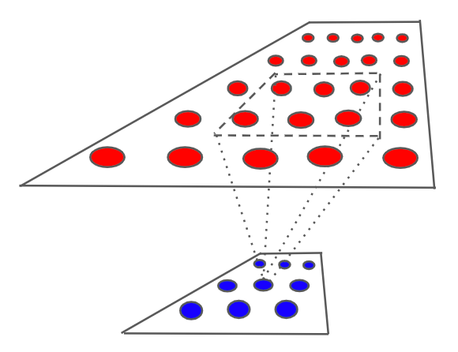

# SpNet: model and usage

What the simulator computes and how to drive it. Everything here is read from the [programming guide](https://github.com/anatoli-starostin/spiky/blob/0ee6c6a7807bddae9f66a6f055b6452dba6816a4/doc/spiky/programming_guide.md) and the code; nothing was run for this page.

## Idea / model

The equations as implemented, and a comparison with Izhikevich's original program (links to its code on his website), are on the [math page](math.md); this page keeps the parameters and the usage.

The architecture document describes SpNet as an implementation of the spiking network model of the polychronization paper (Izhikevich, Neural Computation 2006; the document says 2003), with neuron dynamics, STDP learning and no backpropagation ([architecture](https://github.com/anatoli-starostin/spiky/blob/0ee6c6a7807bddae9f66a6f055b6452dba6816a4/doc/spiky/spiky_highlevel_architecture.md)). Time is discrete: the network advances in *ticks*, and a spike emitted by a neuron reaches its targets after the delay of each synapse.

**Neurons.** Each neuron type is a [`NeuronMeta`](https://github.com/anatoli-starostin/spiky/blob/0ee6c6a7807bddae9f66a6f055b6452dba6816a4/src/spiky/spnet/spnet.py#L12-L40) with the Izhikevich equations (as in the comment of the class)

$$v'=k_2v^2+k_1v+k_0-u+I$$

$$u'=a(bv-u)$$

and the rule that when the voltage reaches the spike threshold it is reset to $c$ and at that moment the recovery variable grows by $d$ as well. Reading: $v$ is the membrane voltage, $u$ the recovery variable and $I$ the input current; the quadratic, linear and constant coefficients (written with letter k above) are `cf_2`, `cf_1` and `cf_0` in the code, and `a`, `b`, `c`, `d` are the usual Izhikevich parameters. The defaults are the classic values (coefficients 0.04, 5, 140, spike threshold 30), and a type also carries the STDP parameters `stdp_decay`, `ltp_max` and `ltd_max`, a reset mode and an optional refractory period. The helper [`LIFNeuronMeta`](https://github.com/anatoli-starostin/spiky/blob/0ee6c6a7807bddae9f66a6f055b6452dba6816a4/src/spiky/spnet/spnet.py#L42-L64) expresses a leaky integrate-and-fire neuron as a setting of the same kernel (quadratic term and recovery switched off).

**Synapses.** Each synapse type is a [`SynapseMeta`](https://github.com/anatoli-starostin/spiky/blob/0ee6c6a7807bddae9f66a6f055b6452dba6816a4/src/spiky/spnet/spnet.py#L66-L96): a learning rate, a range of delays in ticks (0 to 255), a range of weights, an initial weight with optional noise, a weight decay and a weight scaling coefficient. A type with learning rate 0 and equal minimum and maximum weight is a fixed synapse.

**Synapse growth.** Connections are not listed by hand. Every neuron is given 3D coordinates and a neuron type; a type carries *growth commands*. A [`GrowthCommand`](https://github.com/anatoli-starostin/spiky/blob/0ee6c6a7807bddae9f66a6f055b6452dba6816a4/src/spiky/util/synapse_growth.py#L11-L57) says: look in a cuboid placed relative to the neuron, find the neurons of a target type inside it, and connect to each with probability `p`, at most `max_synapses` in total. A [`UniformSamplingGrowthCommand`](https://github.com/anatoli-starostin/spiky/blob/0ee6c6a7807bddae9f66a6f055b6452dba6816a4/src/spiky/util/synapse_growth.py#L59-L83) instead picks a fixed number of random neurons of the target type. The engine runs on the GPU and returns a `ChunkOfConnections`, a packed structure that `SpikingNet.add_connections` consumes directly. The same engine and its helpers (convolution-like windows, random rectangles) also built the connections of the first-generation LUT layers (see [Convolutional networks](../lookup-tables/architectures/convolutional.md)).

## How to run

The native engine must be built (`pip install -v ./native/spiky`, step 4b of the [README](https://github.com/anatoli-starostin/spiky/blob/0ee6c6a7807bddae9f66a6f055b6452dba6816a4/README.md)); the guide's example uses a CUDA device, and the tests also run on CPU. The call sequence of the guide:

1. Create `SpikingNet(synapse_metas, neuron_metas, neuron_counts, ...)` and move it to a device. `summation_dtype` selects float32 or int32 accumulation of the input current.
2. Take neuron identifiers with `get_neuron_ids_by_meta`, register the neuron types in a `SynapseGrowthEngine`, add the neurons with their coordinates, and call `grow(random_seed)`.
3. `spnet.add_connections(connections, random_seed)`, then `spnet.compile()`.
4. `spnet.process_ticks(...)` advances the network by a number of ticks with input spikes (dense, or sparse as a list of neuron identifiers per tick) and `do_train` switching STDP on or off.
5. `export_neuron_data` returns the recorded spikes or voltages of chosen neurons per tick; `export_input_synaptic_weights` and `export_synapses` read the weights back.

Tests are run with `python run_tests_with_different_seeds.py` in [`src/spiky/spnet/tests`](https://github.com/anatoli-starostin/spiky/tree/0ee6c6a7807bddae9f66a6f055b6452dba6816a4/src/spiky/spnet/tests): growth, topology and math tests on CPU and GPU, float32 and int32, two seeds. The runtime test is written to compare spikes, voltages and synaptic weights with reference files (CSV) next to it; the test says its parameters match an `izhikevitch_model.cpp` ([test](https://github.com/anatoli-starostin/spiky/blob/0ee6c6a7807bddae9f66a6f055b6452dba6816a4/src/spiky/spnet/tests/test_izhikevitch_runtime.py#L49)) that is not in the repository, so the origin of the reference files is not recorded.

## Open ideas

None are recorded for the simulator itself; the sources mark only small code TODOs (sparse output of recorded spikes, spherical or conical growth commands).

## Sources

See the list in the [area README](README.md#sources).
